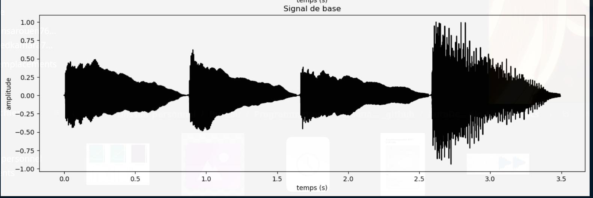
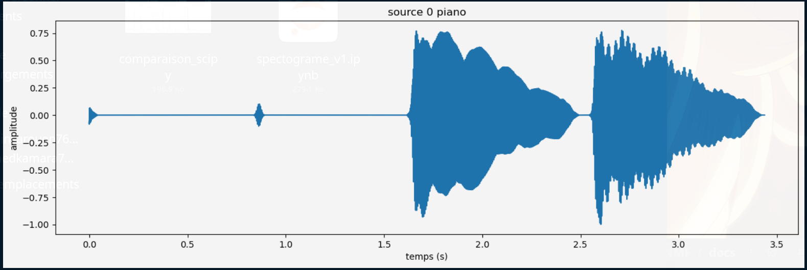
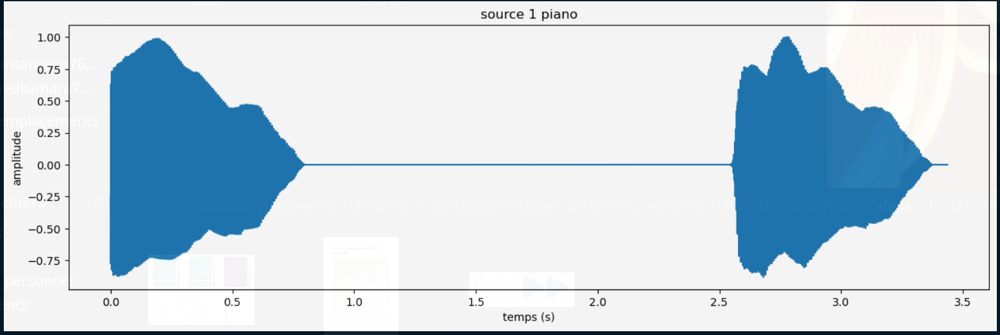
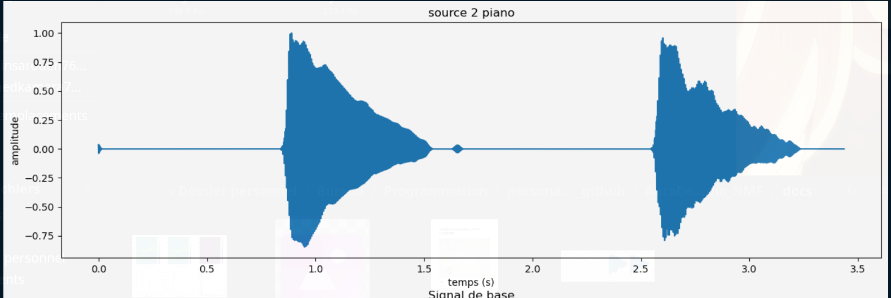

# 🎵 AutoDecomposer — Séparation Audio par NMF & STFT Custom

Projet d'ingénierie mathématique et informatique mené à l'**INSA Rouen Normandie** (Département ISIA).  
Séparation aveugle de sources sonores polyphoniques (Blind Source Separation - BSS) à partir d'un mélange mono par Transformée de Fourier à Court Terme (STFT) custom et Factorisation en Matrices Non-Négatives (NMF).

---

## 🎹 Résultats de Séparation Harmonique (Piano)

| Spectrogramme Mélange Initial | Source Séparée 0 (Fondamentale) |
| :---: | :---: |
|  |  |

| Source Séparée 1 (Harmonique 1) | Source Séparée 2 (Harmonique 2) |
| :---: | :---: |
|  |  |

---

## 🧮 Formulation Mathématique

### 1. STFT from Scratch & Inversion (ISTFT)
Le signal discret $x[n]$ est découpé en trames avec une fenêtre de Hann $w[m]$ et un pas de saut $H$ :
$$X(m, \omega) = \sum_{n=-\infty}^{\infty} x[n] w[n - mH] e^{-j \omega n}$$
La reconstruction temporelle s'effectue par Overlap-Add (OLA) avec normalisation d'énergie.

### 2. Factorisation Matricielle Non-Négative (NMF)
Le spectrogramme d'amplitude $\mathbf{V} \in \mathbb{R}_{+}^{F \times T}$ est factorisé sous la forme :
$$\mathbf{V} \approx \mathbf{W} \cdot \mathbf{H}$$
où $\mathbf{W} \in \mathbb{R}_{+}^{F \times K}$ représente le dictionnaire des spectres de base et $\mathbf{H} \in \mathbb{R}_{+}^{K \times T}$ représente les activations temporelles, estimées par descente multiplicative minimisant la divergence de Kullback-Leibler.

---

## 📑 Rapport & Documentation Scientifique
- 📄 [Consulter le Rapport d'Ingénierie STFT & NMF (PDF)](./docs/Rapport.pdf)
- 🌐 [Consulter la Version Interactive du Rapport (HTML)](./docs/Rapport.html)
- 📋 [Consulter le Sujet Officiel & Spécifications (PDF)](./sujet_PI-2025.pdf)
