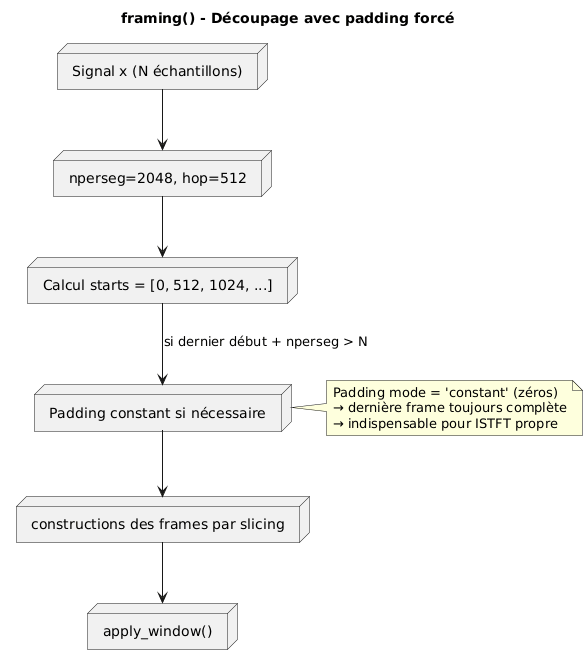
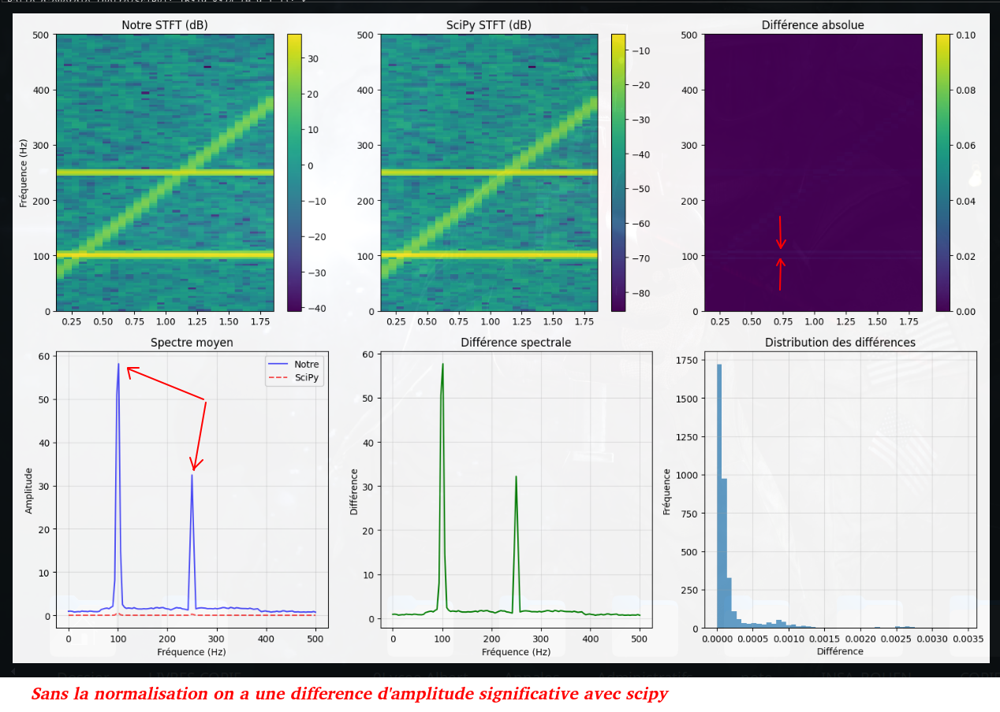
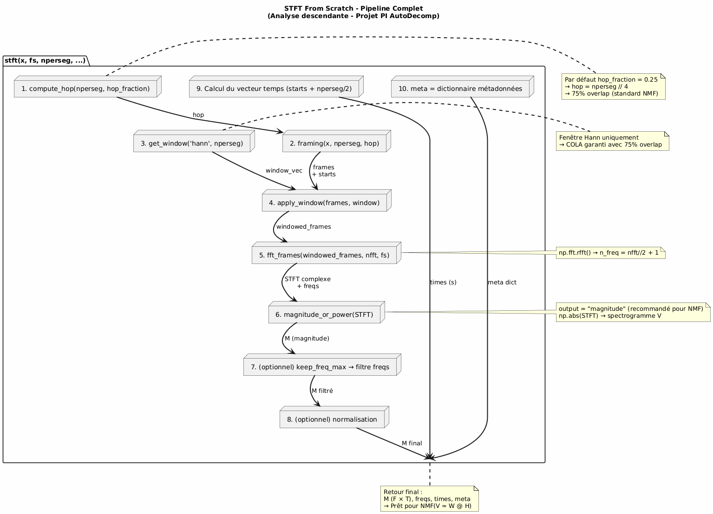
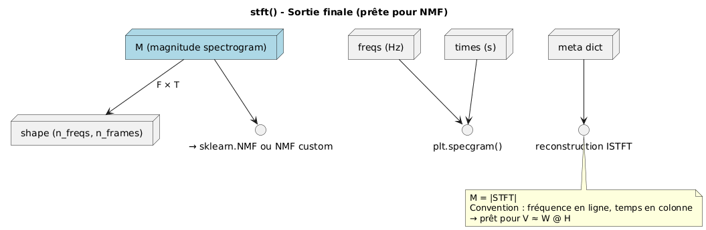

# 🎵 AutoDecomposer — Séparation Audio par NMF & STFT Custom

[](https://www.python.org/)
[](#)
[](https://numpy.org/)

Projet d'ingénierie mathématique et informatique mené à l'**INSA Rouen Normandie** (Département ISIA).  
L'objectif est d'effectuer la **séparation aveugle de sources audio** (Blind Source Separation - BSS) à partir d'un enregistrement mono composite, en reconstruisant les pistes isolées (ex: voix, instruments, percussions).

---

## 🧮 Méthodologie & Fondements Théoriques

```
Signal Audio Temporel x(t)
            │
            ▼
[  STFT from Scratch  ]  ──► Fenêtrage (Hann), TFD glissante, Matrice Complexe X
            │
            ▼
[ Spectrogramme V(f,t)]  ──► Matrice d'amplitude non-négative V = |X|
            │
            ▼
[  NMF Multiplicative ]  ──► Décomposition V ≈ W × H
            │                 W : Dictionnaire spectral (timbres)
            │                 H : Activations temporelles (rythmes)
            ▼
[ Synthèse ISTFT (OLA)]  ──► Masquage de phase de Wiener & Overlap-Add ──► Fichiers .wav isolés
```

### 1. STFT & ISTFT codées from scratch
- Implémentation complète sans recourir à `librosa.stft` pour maîtriser chaque étape physique.
- Découpage en trames (*framing*), pondération par fenêtre de Hann, zero-padding et transformée de Fourier rapide (FFT).
- Reconstruction temporelle par synthèse d'addition-recouvrement (*Overlap-Add - OLA*) avec normalisation énergétique stricte.

### 2. Factorisation Matricielle Non-Négative (NMF)
Le spectrogramme d'amplitude $\mathbf{V} \in \mathbb{R}_+^{F \times T}$ est factorisé en deux matrices de rang réduit $K \ll \min(F, T)$ :
$$\mathbf{V} \approx \mathbf{W} \cdot \mathbf{H}$$
Les matrices $\mathbf{W} \in \mathbb{R}_+^{F \times K}$ et $\mathbf{H} \in \mathbb{R}_+^{K \times T}$ sont estimées par descente de gradient multiplicative basée sur la divergence de Kullback-Leibler généralisée :
$$H_{k,t} \leftarrow H_{k,t} \frac{\sum_f W_{f,k} V_{f,t} / (WH)_{f,t}}{\sum_f W_{f,k}}, \quad W_{f,k} \leftarrow W_{f,k} \frac{\sum_t H_{k,t} V_{f,t} / (WH)_{f,t}}{\sum_t H_{k,t}}$$

---

## 📊 Résultats & Spectrogrammes

| Découpage Temporel & Fenêtrage (*Framing*) | Spectrogramme Temps-Fréquence Reconstruit |
| :---: | :---: |
|  |  |

| Analyse Descendante du Pipeline | Sortie STFT Finale |
| :---: | :---: |
|  |  |

---

## 📁 Organisation du Code

- `stft_from_scratch/` : Modules Python de calcul de la transformée de Fourier à court terme et inversion.
- `Matrice_M_et_Decomp.ipynb` : Notebook d'expérimentation matricielle et factorisation NMF.
- `Projet_A_l_Aide_de_Librairie.ipynb` : Benchmark comparatif avec Scikit-Learn et Librosa.
- `son/` : Fichiers audios de test et sources synthétiques isolées.

---

## 📑 Rapport & Documentation Scientifique
- 📄 [Consulter le Rapport Scientifique STFT & NMF (PDF)](./docs/Rapport_AutoDecomposer_NMF.pdf)
- 📋 [Consulter le Sujet Officiel & Spécifications (PDF)](./sujet_PI-2025.pdf)
