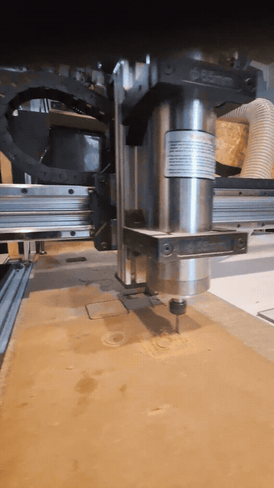
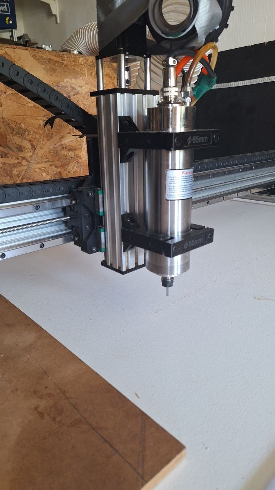

# ⚙️ Pipeline FAO & Usinage CNC — QueenBee Pro · Estlcam · DDCS V3.1

[](#)
[](#)
[](#)
[](#)

Projet d'ingénierie d'intégration matérielle et logicielle pour une fraiseuse numérique **CNC QueenBee Pro** (châssis aluminium renforcé, rails linéaires, vis à billes).  
Mise en place de l'intégralité du pipeline de **Fabrication Assistée par Ordinateur (FAO)** permettant de passer d'un modèle CAO 3D à une pièce usinée avec une précision micrométrique.

---

## 🎬 Démonstrations Visuelles

| **Usinage en Cours sur Fraiseuse CNC** | **Châssis QueenBee Pro & Contrôleur** |
| :---: | :---: |
|  |  |
| *Fraisage haute vitesse avec broche VFD et évacuation de copeaux.* | *Montage mécanique, vis à billes et contrôleur autonome DDCS V3.1.* |

---

## 🏗️ Architecture du Pipeline Numérique

```
[ SketchUp / Fusion360 ]  ──► Modélisation CAO 2.5D / 3D (export DXF / STL)
            │
            ▼
[     Estlcam (FAO)    ]  ──► Définition des parcours d'outils, poches, contournages
            │                 Paramètres d'avance F, vitesse broche S, Dogbones
            │                 Génération du G-code standardisé (.nc) via post-proc Mach3
            ▼
[  Clé USB / Transfert ]  ──► Acheminement du fichier G-code vers la machine
            │
            ▼
[ Contrôleur DDCS V3.1 ]  ──► Homing automatique, Palpage Zéro Pièce (méthode papier / probe)
            │                 Interpolation linéaire et circulaire temps réel (4 axes)
            ▼
[ Fraiseuse QueenBee Pro] ──► Usinage réel dans le bois massif, MDF, plexiglas ou alu
```

---

## 🔧 Réalisations Techniques & Résolution de Problèmes

1. **Configuration du Post-Processeur Mach3 pour DDCS :**
   - Paramétrage de la syntaxe des arcs de cercle `G02` / `G03` (coordonnées incrémentales I/J).
   - Gestion des cycles de perçage `G81` et des temporisations de démarrage broche `G04`.
2. **Calibration Fine des Axes ($Steps/mm$) :**
   - Calcul théorique du ratio :
     $$\text{Steps/mm} = \frac{\text{Pas moteur} \times \text{Microstepping}}{\text{Pas de la vis à billes}} = \frac{200 \times 8}{4} = 400\text{ steps/mm}$$
   - Diagnostic et correction du comportement de l'axe Z (élimination des pertes de pas en plongée).
3. **Usinage d'Inlays Plexiglas & Tolérances :**
   - Gestion du rayon de fraise dans les angles intérieurs (ajout d'overcuts / *dogbones* pour assembler des angles droits parfaits).
   - Ajustement serré avec tolérance d'encastrement de $-0.2\text{ mm}$.

---

## 📑 Documentation Technique & Manuels
- 📄 [Consulter le Guide d'Opération Standard CNC V1 (PDF)](./docs/guide_V1.pdf)
- 📋 [Datasheet & Spécifications du Contrôleur DDCS V3.1 (PDF)](./docs/DS_DDCSV3.1.pdf)
