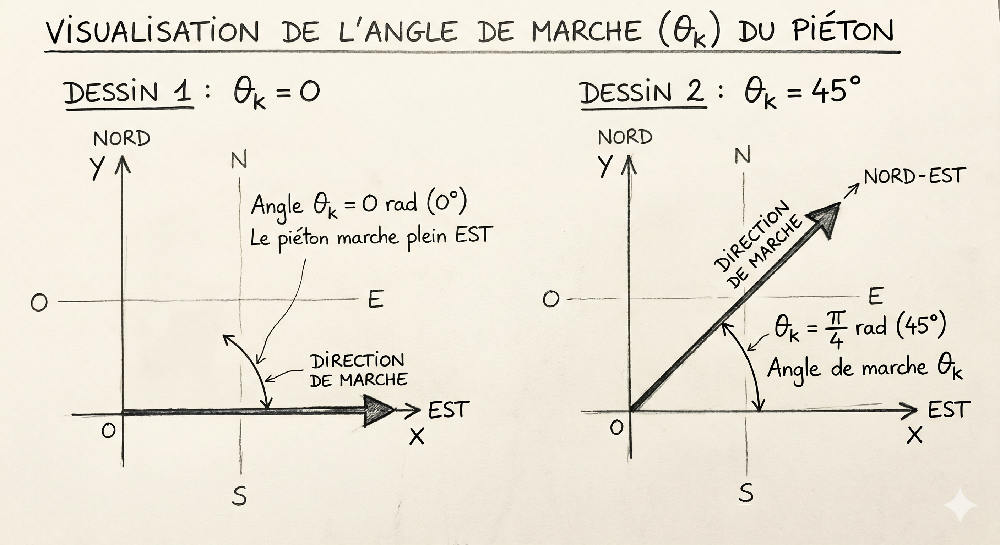
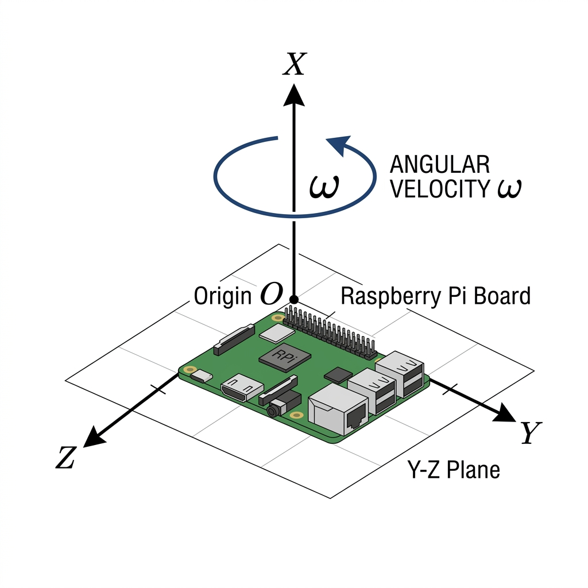

# Modèle Cinématique du Filtre de Kalman Étendu (EKF) pour Piéton

Ce document détaille la théorie mathématique de la méthode qui a été validée pour notre projet de fusion de capteurs (fichier `EKFSansMagneto`).

> [!NOTE]
> **Pourquoi ce modèle ?**
> Après de multiples essais, nous avons abandonné la double intégration de l'accélération (trop de dérive due à la gravité et aux pas) et l'usage du magnétomètre (trop d'interférences magnétiques extérieures). Ce modèle cinématique s'appuie uniquement sur :
> 1. La vitesse scalaire déduite du GPS ($v$).
> 2. La vitesse de rotation autour de l'axe vertical donnée par le gyroscope ($\omega$).

---

## 1. Vecteur d'État ($X$)
Nous modélisons le piéton dans un plan 2D local (repère Est-Nord).
Le vecteur d'état $X_k$ à l'instant $k$ contient 3 variables :
```math
 X_k = \begin{bmatrix} x_k \\ y_k \\ \theta_k \end{bmatrix} 
```
Où :
*   $x_k$ : Position vers l'Est (en mètres)
*   $y_k$ : Position vers le Nord (en mètres)
*   $\theta_k$ : Cap ou orientation (en radians, où 0 = pointé vers l'Est)



## 2. Vecteur de Commande ($U$)
Le système est piloté par nos capteurs (qui agissent ici comme des commandes de notre système cinématique) :
```math
 U_k = \begin{bmatrix} v_k \\ \omega_k \end{bmatrix} 
```
Où :
*   $v_k$ : Vitesse scalaire du piéton en $m/s$ (calculée via $v = \frac{\Delta \text{distance GPS}}{\Delta t}$).
*   $\omega_k$ : Vitesse angulaire en $rad/s$ (mesurée directement par l'axe X du gyroscope : `Gyro_X`).

> [!NOTE]
> **Axe Vertical (X) et Vitesse Angulaire ($\omega$)**  
> L'image ci-dessous illustre le montage matériel. L'axe X pointe vers le haut (attraction gravitationnelle d'1G), et la rotation du piéton correspond au gyroscope autour de cet axe.
> 

---

## 3. Étape de Prédiction (Propagation)

### Modèle Non-Linéaire ($f$)
L'évolution de la position du piéton n'est pas linéaire à cause des fonctions trigonométriques $\cos$ et $\sin$.
```math
 X_{k} = f(X_{k-1}, U_k) + W_k 
```
Ce qui se traduit par les équations de mécanique classique :
```math
 \begin{bmatrix} x_k \\ y_k \\ \theta_k \end{bmatrix} = \begin{bmatrix} x_{k-1} + v_k \cdot \cos(\theta_{k-1}) \cdot \Delta t \\ y_{k-1} + v_k \cdot \sin(\theta_{k-1}) \cdot \Delta t \\ \theta_{k-1} + \omega_k \cdot \Delta t \end{bmatrix} 
```

### Jacobienne ($F$)
Pour appliquer Kalman (qui est un filtre linéaire), nous devons linéariser la fonction $f$ autour de la position actuelle en calculant sa matrice Jacobienne (les dérivées partielles par rapport à $x, y$ et $\theta$) :
```math
 F_k = \frac{\partial f}{\partial X} = \begin{bmatrix} 1 & 0 & -v_k \cdot \sin(\theta_{k-1}) \cdot \Delta t \\ 0 & 1 & v_k \cdot \cos(\theta_{k-1}) \cdot \Delta t \\ 0 & 0 & 1 \end{bmatrix} 
```
*Cette matrice $F_k$ est cruciale : elle indique comment une petite erreur sur le cap ($\theta$) se propage de manière géométrique sur les erreurs de position $x$ et $y$.*

### Bruit de Processus ($Q$)
La matrice de covariance $Q$ représente l'incertitude de notre prédiction (notre modèle suppose une vitesse constante, or le piéton marche avec des petits à-coups d'accélération).
Cette formulation est issue du modèle **CWNA** (*Continuous White Noise Acceleration*), un standard en navigation (référence : *cours de Navigation, Slides 66-67 du CM6*).

**Dérivation Physique :**
1. **Erreur sur la position ($x, y$) :** L'équation de la cinématique relie la position à l'accélération via $\frac{1}{2} a \Delta t^2$. Si le piéton subit un bruit d'accélération aléatoire $w_a$, l'erreur générée sur la position est $\frac{1}{2} w_a \Delta t^2$. 
   La variance (l'erreur au carré) devient alors : $\left(\frac{1}{2} \Delta t^2\right)^2 \sigma_a^2 = \mathbf{\frac{\sigma_a^2 \cdot \Delta t^4}{4}}$.
2. **Erreur sur l'angle ($\theta$) :** L'angle est lié à la vitesse de rotation par $\omega \Delta t$. L'erreur due au bruit du gyroscope $w_\omega$ est $w_\omega \Delta t$. 
   La variance devient donc : $\mathbf{\sigma_\omega^2 \cdot \Delta t^2}$.

Ce qui donne notre fameuse matrice $Q$ :
```math
 Q = \begin{bmatrix} \frac{\sigma_a^2 \cdot \Delta t^4}{4} & 0 & 0 \\ 0 & \frac{\sigma_a^2 \cdot \Delta t^4}{4} & 0 \\ 0 & 0 & \sigma_\omega^2 \cdot \Delta t^2 \end{bmatrix} 
```
* $\sigma_a$ est la variance de l'accélération horizontale (calculée **dynamiquement** à chaque pas de temps via l'IMU pour s'adapter à la force du pas).
* $\sigma_\omega$ est la variance du bruit du gyroscope.

**Mise à jour de la confiance (Prédiction de P)** :
```math
 P_k^- = F_k P_{k-1} F_k^T + Q 
```

---

## 4. Étape de Correction (Mise à jour par GPS)

### Modèle d'Observation ($H$)
Nous mesurons uniquement la position $(x, y)$ grâce au GPS, mais pas le cap $\theta$. La matrice d'observation $H$ est donc très simple :
```math
 H = \begin{bmatrix} 1 & 0 & 0 \\ 0 & 1 & 0 \end{bmatrix} 
```

L'observation attendue est : 
```math
Z_k = H \cdot X_k = \begin{bmatrix} x_{gps} \\ y_{gps} \end{bmatrix}
```

### Bruit de Mesure ($R$)
La matrice $R$ représente l'imprécision du GPS (obtenue expérimentalement lors des tests à l'arrêt) :
```math
 R = \begin{bmatrix} 1.20 & 0 \\ 0 & 0.07 \end{bmatrix} 
```

### Filtre Anti-Outliers (Distance de Mahalanobis)
Avant d'accepter une mesure GPS, nous vérifions si elle est mathématiquement aberrante (GPS multipath ou saut soudain).
1. **Innovation** : 
   ```math
   \tilde{y} = Z_k - H X_k^-
   ```
2. **Covariance de l'innovation** : 
   ```math
   S = H P_k^- H^T + R
   ```
3. **Distance de Mahalanobis** : 
   ```math
   d^2 = \tilde{y}^T S^{-1} \tilde{y}
   ```

> [!WARNING]
> Si le carré de la distance de Mahalanobis ($d^2 > 9.21$) dépasse le seuil de la loi du Chi-Carré à 99% de confiance pour 2 degrés de liberté, la mesure GPS est considérée fausse. L'EKF la rejette et ne fonctionne qu'avec le Gyroscope pendant ce pas de temps.

### Équations de Correction Finales
Si le GPS est valide, on corrige l'état :
1. **Gain de Kalman** : 
   ```math
   K = P_k^- H^T S^{-1}
   ```
2. **Correction de l'État** : 
   ```math
   X_k = X_k^- + K \tilde{y}
   ```
3. **Mise à jour de la covariance** : 
   ```math
   P_k = (I - K H) P_k^-
   ```

---

## 5. Avantages et Limites de ce Modèle

### Limites
* **Dérive du Gyroscope (Drift)** : L'intégration d'un gyroscope dérive lentement au fil du temps à cause de l'accumulation de l'erreur numérique. Si le GPS venait à disparaître (dans un tunnel) pendant trop longtemps, le cap $\theta$ finirait irrémédiablement par dévier.
* **Vitesse dépendante du GPS** : La vitesse $v$ étant calculée via le GPS, une perte totale du signal GPS force la vitesse à $v = 0$ (ou une vitesse constante si on gardait la dernière connue). Le système ne peut donc pas faire de véritable navigation sur de très longues distances sans GPS.
