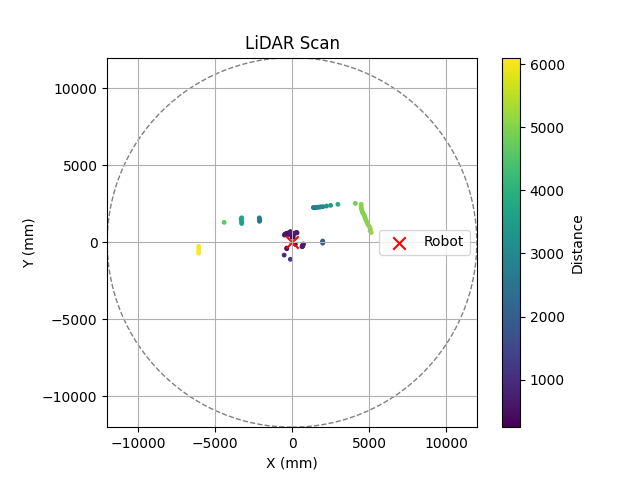
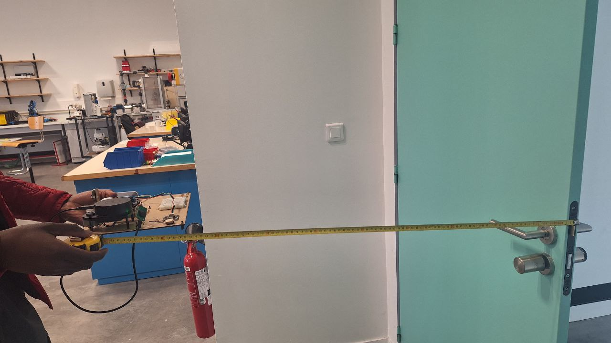
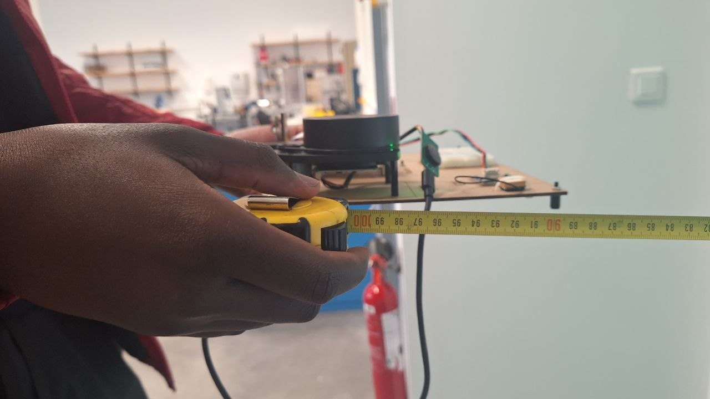
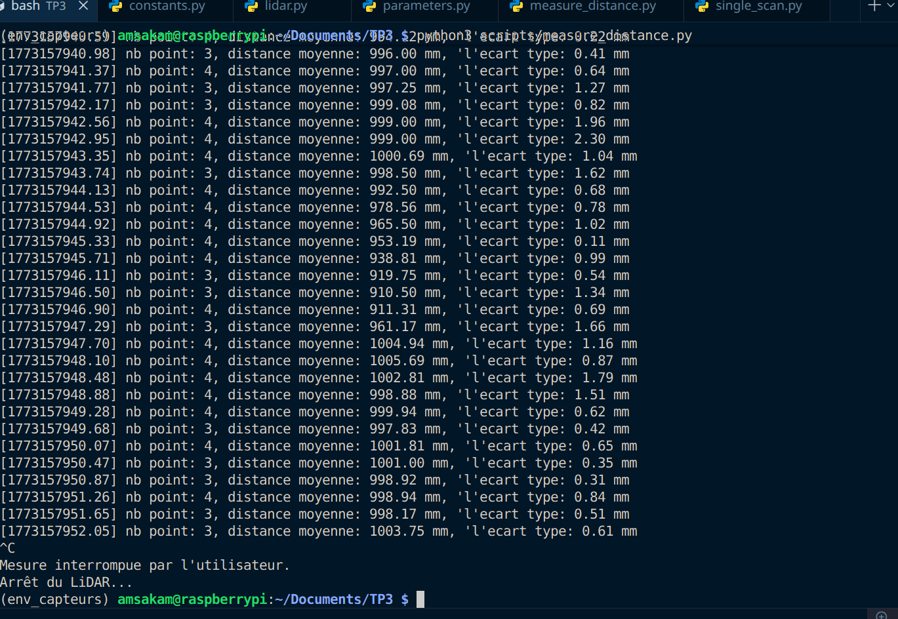
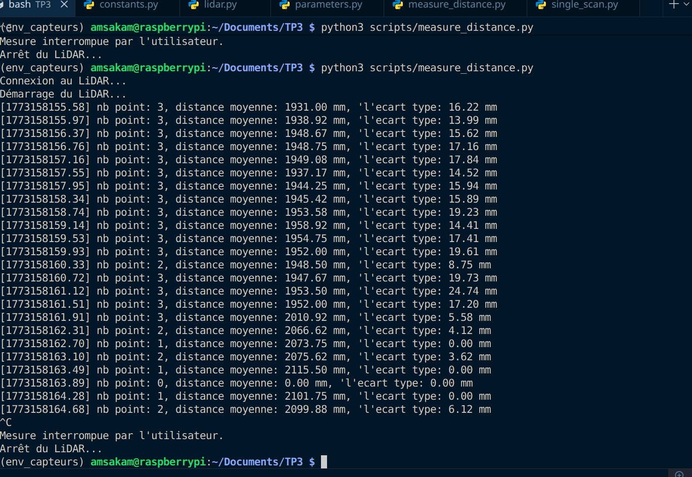
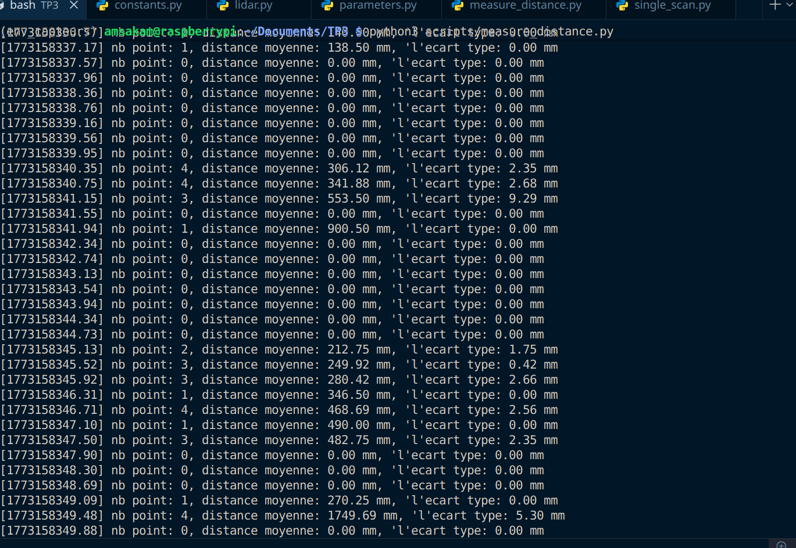
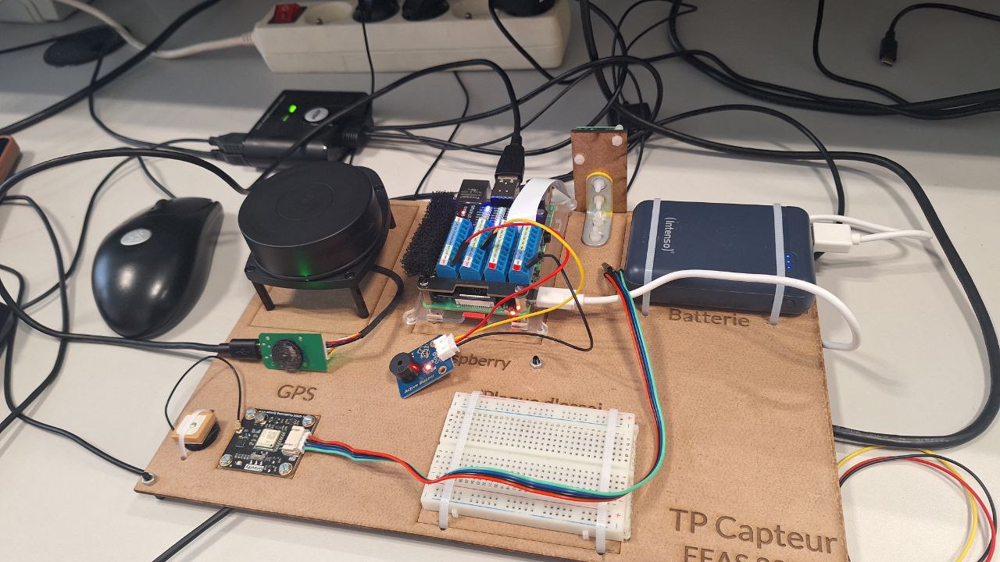
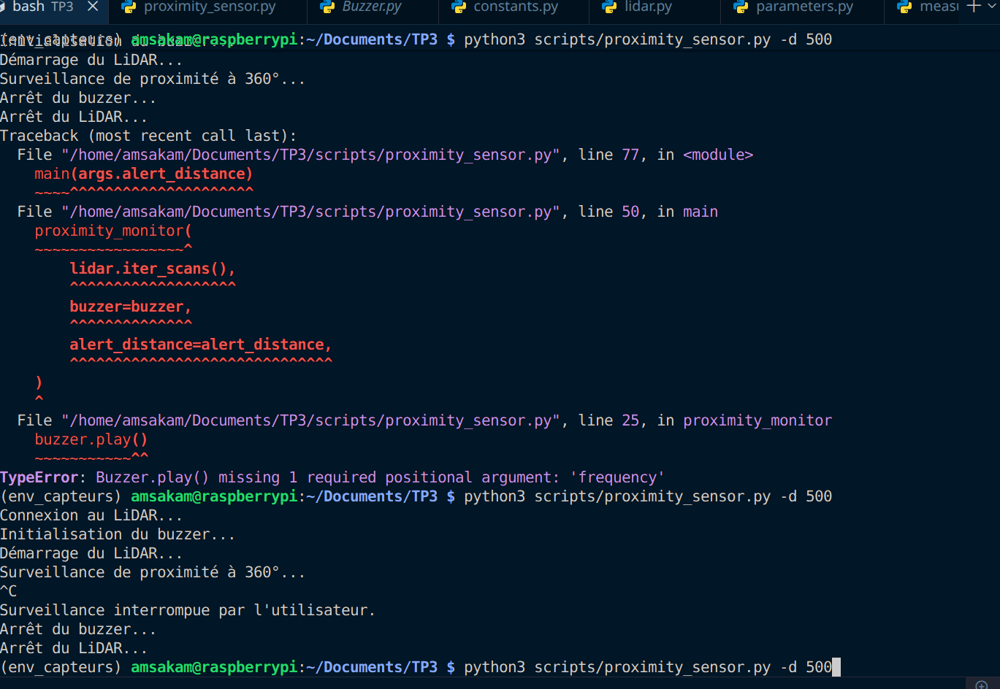

# Compte rendu TP3 : LiDAR
> KAMARA Mohamed et DIOP Amsatou  
> 11 mars 2026

---

## Partie 2 : C'est quoi un LiDAR 2D ?

- **Dans quel plan en 2D sont effectuées les mesures ?**
  Les mesures sont effectuées dans le **plan horizontal**.

- **Sachant que la tête du LiDAR tourne constamment, comment l'envoi et la réception du signal lumineux se fait-il ?**
  *(d'après le cours)*
  Le LiDAR possède un système de transmission sans fil mixte   **optique pour les données** et **couplage magnétique/sans contact pour l'alimentation**. Cela lui permet de tourner à 360° en continu sans enrouler de câbles.

- **Comment la distance est calculée à partir du signal lumineux ?**
  Le RPLIDAR A1 utilise la télémétrie par **triangulation laser**. Un laser infrarouge modulé est émis, rebondit sur l'obstacle, et le reflet est capturé par un capteur d'acquisition haute vitesse. La distance est déduite grâce à l'angle sous lequel le rayon réfléchi est observé.

---

## Partie 3 : Mise en place

**Manipulation matérielle :**
1. Brancher le LiDAR en USB.
2. Identifier le port avec `ls /dev/*USB*`  -> sur notre machine : `/dev/ttyUSB1`.
3. **Modification dans `config/constants.py`** :

```python
# config/constants.py
PORT_LIDAR = "/dev/ttyUSB1"   # Port USB connecté au LiDAR
PORT_BUZZER = 24              # Port GPIO du buzzer

# Constantes de configuration du LiDAR
LIDAR_MIN_RANGE = 150         # Portée minimale du LiDAR en mm
LIDAR_MAX_RANGE = 12000       # Portée maximale du LiDAR en mm
```

---

## Partie 4 : You spin me right round, baby, right round

### 4.1 – Portées du LiDAR (`config/constants.py`)

Selon la documentation (Datasheet, p.8), la portée minimale (typical) est de **0,15 m** et la portée maximale de **12 m**.

```python
LIDAR_MIN_RANGE = 150    # 150 mm
LIDAR_MAX_RANGE = 12000  # 12 000 mm
```

### 4.2 – Exécution de `single_scan.py`

Premier lancement du script :



- **Combien de mesures contient le scan ?**
  Lors de notre scan, nous avons obtenu **89 mesures**. La documentation indique  a peu prés 1450 mesures par tour à 5,5 Hz, mais les filtres de qualité réduisent ce nombre de mesures.

- **Quelles informations pour chaque mesure, format, unité ?**
  Chaque mesure est un **tuple de 3 éléments** : `(Qualité, Angle, Distance)`.
  - Qualité : entier entre 0 et 15
  - Angle : flottant en **degrés**
  - Distance : flottant en **mm**

### 4.3 – Fonctions implémentées dans `sensors/LIDAR/lidar.py`

#### `polar_to_cartesian(self, scan)`

> **Logique :** L'axe à 0° est en face du capteur. x = 0 pour 0° et 180°  -> composante `sin(angle)` ; y = 0 pour 90° et 270°  -> composante `cos(angle)`.

```python
def polar_to_cartesian(self, scan):
    """
    Convertit les coordonnées polaires (angle, distance) en coordonnées cartésiennes (x, y).
    """
    points = []
    for quality, angle, distance in scan:
        rad = math.radians(angle)
        x = distance * math.sin(rad)
        y = distance * math.cos(rad)
        points.append((x, y))
    return points
```

#### `filter_quality(self, scan)`

```python
def filter_quality(self, scan):
    """
    Filtre les points du scan en ne conservant que ceux dont la qualité
    dépasse le seuil défini.
    """
    return [meas for meas in scan if meas[0] >= self.quality_threshold]
```

#### `filter_angle(self, scan)`

> **Note :** La condition `min_angle > max_angle` gère le cas d'un angle « à cheval » sur 0° (ex. : 270° à 90°).

```python
def filter_angle(self, scan):
    """
    Filtre les points du scan en fonction de la plage d'angle définie.
    """
    filtered = []
    for meas in scan:
        quality, angle, distance = meas
        # Cas classique (ex: 10° à 170°)
        if self.min_angle <= self.max_angle:
            if self.min_angle <= angle <= self.max_angle:
                filtered.append(meas)
        # cas particulier 270° à 90°
        else:
            if angle >= self.min_angle or angle <= self.max_angle:
                filtered.append(meas)
    return filtered
```

#### `filter_range(self, scan)`

```python
def filter_range(self, scan):
    """
    Filtre les points du scan en fonction de la range de distance définie.
    """
    return [meas for meas in scan if self.min_range <= meas[2] <= self.max_range]
```

**Paramètres utilisés (config/parameters.py) :**

```python
MIN_DETECTION_RANGE  = 60      # mm
MAX_DETECTION_RANGE  = 3000    # mm
MIN_DETECTION_ANGLE  = 270     # degrés (secteur avant : 270°  -> 90°)
MAX_DETECTION_ANGLE  = 90      # degrés
QUALITY_THRESHOLD    = 12      # entre 0 et 15
SCAN_SKIP            = 3       # ignorer X scans
```

---

## Partie 5 : Au millimètre près ?

### Caractéristiques de la datasheet

| Paramètre              | Valeur                    |
|------------------------|---------------------------|
| Fréquence de scan      | 5,5 Hz (1 à 10 Hz config) |
| Précision              | < 1&#37; de la distance   |
| Résolution en distance | < 0,5 mm                  |
| Résolution angulaire   | =< 1°                      |

**Différence Précision / Résolution :**
- La **résolution** est le plus petit écart mesurable
- La **précision** est l'écart maximal entre la valeur mesurée et la réalité (l'erreur) (a quelle point on peut faire confiance a la mesure)

### Code complété   `scripts/measure_distance.py`

```python
def measure_distance(scan_iterator, save_path=None):
    """
    Fonction qui mesure la distance moyenne dans un secteur angulaire prédéfini.
    """
    for timestamp, scan, points in scan_iterator:

        distances = [meas[2] for meas in scan]

        if len(distances) > 0:
            mean_distance = np.mean(distances)
            std_distance  = np.std(distances)
        else:
            mean_distance = 0
            std_distance  = 0

        print(f"[{timestamp:.2f}] nb point: {len(distances)}, "
              f"distance moyenne: {mean_distance:.2f} mm, "
              f"l'ecart type: {std_distance:.2f} mm")

        yield timestamp, mean_distance, std_distance
```

### Résultats des mesures

Exemples de lignes du fichier `mesure_mur_1m.csv` (format : `timestamp, distance_moyenne_mm, ecart_type_mm`) :

| Timestamp        | Distance moy. (mm) | Écart-type (mm) |
|------------------|--------------------|-----------------|
| …675.83          | 949,56             | 0,67            |
| …676.23          | 948,83             | 1,85            |
| …676.63          | 949,25             | 1,57            |




**Graphique de mesure à 1 m face au mur :**



**Graphique de mesure à 2 m face au mur :**



**Test face à une fenêtre (surface vitrée) :**



**Observation :** 
> Mesurer à travers une vitre ou sur une surface vitrée provoque de nombreuses erreurs le laser passe au travers ou est mal réfléchi ce qui provoque grand un écart-type. 
> Plus l'angle d'incidence augmente, plus la précision diminue de meme que si la distance augmente (erreur d'offset et erreur de sensibilité).

---

## Partie 6 : WEEEU WEEEU, CECI EST UNE DESCENTE DE POLICE !

### 6.1 – Détecteur de proximité (`scripts/proximity_sensor.py`)

**Principe :** Si au moins une mesure du scan est inférieure à `alert_distance`, on active le buzzer.

```python
def proximity_monitor(scan_iterator, buzzer, alert_distance):
    """
    Active le buzzer lorsqu'un obstacle est détecté
    à une distance inférieure au seuil.
    """
    for timestamp, scan, points in scan_iterator:
        distances = [meas[2] for meas in scan]
        if any(d < alert_distance for d in distances):
            """
            Do: 261.63 Hz
            Re: 293.66 Hz
            Mi: 329.63 Hz
            Fa: 349.23 Hz
            Sol: 392.00 Hz
            La: 440.00 Hz
            Si: 493.88 Hz
            """
            buzzer.play(261.63)
            sleep(1)            
            buzzer.play(293.66)
            sleep(1)            
            
            buzzer.play(329.63)
            sleep(1)            
            
            buzzer.play(349.23)
            sleep(1)            
            
            buzzer.play(392.00)
            sleep(1)            
            
            buzzer.play(440.00)
            sleep(1)            
            
            buzzer.play(493.88)
        else:
            buzzer.stop()
```

**Branchement du buzzer :**
> Classic : alimentation + masse + data



**Test du détecteur de proximité :**
> Distance minimale : 500 mm



### 6.2 – Détecteur de mouvement (`scripts/motion_sensor.py`)

**Principe :** Chaque scan est converti en « signature angulaire » (liste de distances moyennes par secteur angulaire) via `scan_to_bins`. On compare la signature courante à la précédente ; si la différence dans un secteur dépasse `motion_threshold`, le buzzer est activé.

**`scan_to_bins` :**

```python
def scan_to_bins(scan, num_bins=36, default_distance=None):
    """
    Convertit un scan LiDAR en signature angulaire discrète.
    Retourne une liste de taille num_bins, où chaque élément est
    la distance moyenne des points dans un secteur de (360/num_bins)°.
    """
    if default_distance is None:
        default_distance = LIDAR_MAX_RANGE

    bins      = [[] for _ in range(num_bins)]
    bin_width = 360.0 / num_bins

    for quality, angle_deg, distance_mm in scan:
        angle_deg = angle_deg % 360.0
        bin_index = int(angle_deg // bin_width)
        if bin_index >= num_bins:
            bin_index = num_bins - 1
        bins[bin_index].append(distance_mm)

    signature = []
    for values in bins:
        if values:
            signature.append(sum(values) / len(values))
        else:
            signature.append(None)

    return signature
```

**`motion_monitor` :**

```python
def motion_monitor(scan_iterator,
                   buzzer,
                   max_range=LIDAR_MAX_RANGE,
                   motion_threshold=200.0,
                   num_bins=36):
    """
    Détecte un mouvement en comparant chaque scan au précédent.
    """

    for timestamp, scan, points in scan_iterator:
        precedent_signature = None       # Notre (de frappe) erreur ici
        signature = scan_to_bins(
            scan,
            num_bins=num_bins,
            default_distance=max_range
        )
        
        if precedent_signature is not None:
            differences = []
            
            for prec, actu in zip(precedent_signature, signature):
                if prec is not None and actu is not None:
                    differences.append(abs(prec - actu))
                    
            if differences:
                if any(d > motion_threshold for d in differences):
                    buzzer.play(440)
                else:
                    buzzer.stop()
                    
        precedent_signature = signature
```

> **Notre code ne fonctionnait pas.** `precedent_signature` est déclarée à `None` **à l'intérieur** de la boucle `for`, ce qui provoquait sa réinitialisation à chaque itération. Donc la condition `if precedent_signature is not None` est **toujours fausse** : la comparaison n'est jamais effectuée et le buzzer ne se déclenche jamais.
Correction : il suffit de le mettre hors de la boucle (normalement ça marche).

