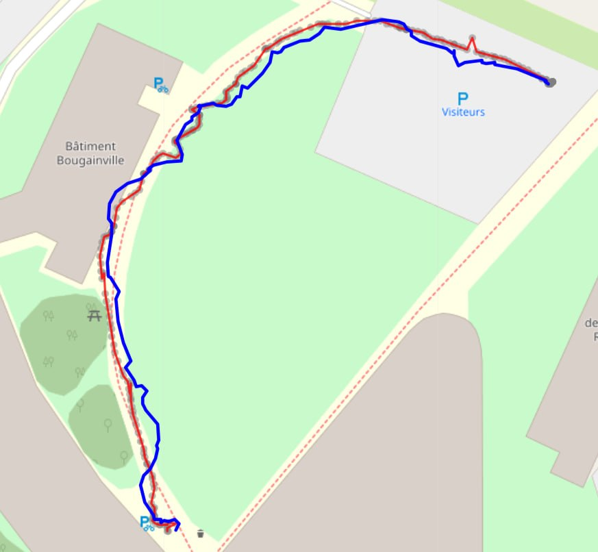
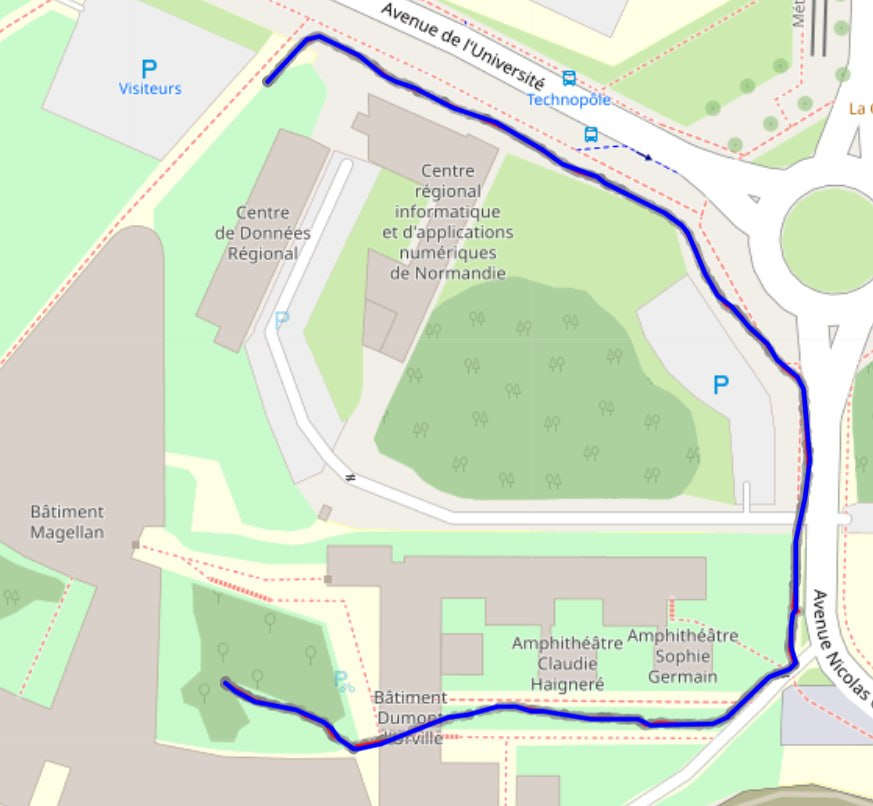
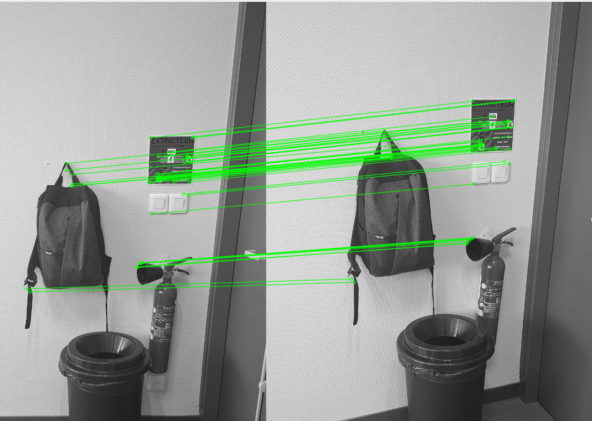

# 📍 Localisation Piéton & Fusion Stochastique de Capteurs (EKF) · 18/20

[](https://www.python.org/)
[](#)
[](#)
[](#)

Projet Intégratif d'excellence récompensé par la note de **18/20** à l'**INSA Rouen Normandie** (Département ITI / ISIA).  
Conception et déploiement d'une chaîne complète de **fusion de capteurs stochastique** (Filtre de Kalman Étendu - EKF) pour localiser un piéton en milieu urbain et indoor dense à partir d'un récepteur **GNSS TEL0157** et d'une centrale inertielle **IMU LSM6DSO 9 axes**.

---

## 📸 Matériel Embarqué & Tests Terrain

| **Acquisition Terrain Piéton** | **Boîtier Capteurs & Montage** |
| :---: | :---: |
|  |  |
| *Session d'acquisition réelle sur le campus INSA Rouen (tracé Strava en référence).* | *Centrale inertielle 9-DOF et récepteur GNSS couplés sur Raspberry Pi.* |

| **Correspondance Visuelle de Poses (ORB)** |
| :---: |
|  |
| *Extraction et appariement de descripteurs ORB pour la validation d'odométrie visuelle.* |

---

## 🧮 Modélisation Mathématique EKF

Le vecteur d'état cinématique piéton s'écrit :
$$\mathbf{x}_k = \begin{bmatrix} p_N \\ v_N \\ p_E \\ v_E \end{bmatrix}_k$$

### 1. Équation de Prédiction (Inertielle)
$$\mathbf{x}_{k|k-1} = \mathbf{F} \mathbf{x}_{k-1|k-1} + \mathbf{B} \mathbf{u}_k$$
$$\mathbf{P}_{k|k-1} = \mathbf{F} \mathbf{P}_{k-1|k-1} \mathbf{F}^T + \mathbf{Q}$$

La matrice de covariance de bruit de procédé $\mathbf{Q}$ a été étalonnée expérimentalement sur l'accéléromètre au repos et en marche : $\sigma_a = 0.8596\text{ m/s}^2$.

### 2. Gating de Mahalanobis pour Rejet des Trames GPS Aberrantes
Afin de prévenir les sauts aberrants lors de pertes de fix GPS en milieu abrité, chaque mesure $\mathbf{z}_k$ subit un test statistique de Mahalanobis avant intégration :
$$d_M^2 = (\mathbf{z}_k - \mathbf{H}\mathbf{x}_{k|k-1})^T \mathbf{S}_k^{-1} (\mathbf{z}_k - \mathbf{H}\mathbf{x}_{k|k-1}) \le \gamma$$
Pour un seuil $\chi^2$ à 2 degrés de liberté au niveau de confiance de $99\%$, $\gamma = 9.21$. Les mesures au-delà sont automatiquement rejetées.

---

## 🚀 Exécution & Cartographie

### 1. Installer les dépendances
```bash
pip install numpy pandas folium scipy matplotlib
```

### 2. Lancer la fusion et générer la carte
```bash
python3 kalman_gps_imu.py
```
Les cartes générées dans `Final_Test/Resultats_HTML/` utilisent des tuiles **CartoDB Voyager** haute disponibilité, évitant tout blocage de flux cartographique.

---

## 📑 Rapport Technique & Documents Scientifiques
- 📄 [Consulter le Rapport de Fusion Capteurs & EKF (PDF)](./docs/Rapport_Fusion_EKF.pdf)
- 📊 [Consulter la Présentation de Fusion Stochastique & Filtrage de Kalman (PDF)](./03_Rapports_et_Documents/Beamer_Capteur_CM6_Kalman.pdf)
