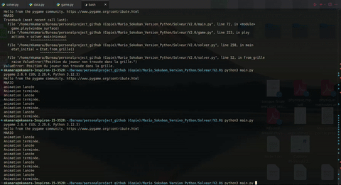

# 📦 Mario Sokoban — Moteur de Jeu & Solveur d'Espace d'États

[](https://www.python.org/)
[](https://www.pygame.org/)
[](#)

Implémentation complète du jeu de réflexion culte **Sokoban** avec un moteur graphique sous Pygame et un **solveur automatisé** capable d'explorer l'arbre des configurations pour trouver la séquence minimale de poussées.

---

## 🎬 Démonstration du Solveur Automatisé



---

## 🧠 Algorithme du Solveur (Espace d'États & Deadlocks)

### 1. Représentation d'une Configuration
L'état du plateau est encodé par la position du joueur et l'ensemble ordonné des positions des caisses :
$$\mathbf{S} = (p_{\text{joueur}}, \{p_{\text{caisse}_1}, p_{\text{caisse}_2}, \dots, p_{\text{caisse}_k}\})$$
Une table de hachage (*closed set*) mémorise les états déjà visités pour éliminer les cycles d'exploration.

### 2. Détection Précoce des Impasses (*Deadlock Detection*)
Pour réduire drastiquement l'arbre combinatoire :
- **Deadlock de coin :** Si une caisse est poussée dans un coin (2 murs orthogonaux) qui n'est pas un objectif, la branche est immédiatement coupée (*pruning*).
- **Deadlock de ligne :** Si deux caisses sont côte à côte le long d'un mur sans cible.

---

## 🚀 Lancer le jeu
```bash
python3 Solveur/V2.0/game.py
```
