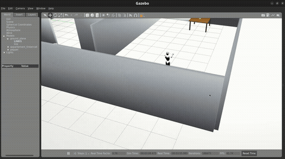
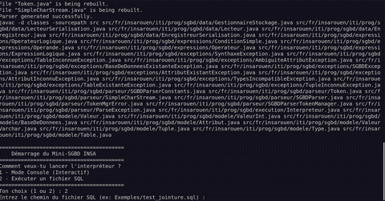

# 🚀 Mohamed Kamara — Software Engineering, Embedded Systems & Applied AI

[](https://www.linkedin.com/in/mohamed-kamara-a505b8256/)
[](https://mohamedkamara7613.github.io/Portfolio_page/)
[](https://github.com/mohamedkamara7613)
[](https://www.youtube.com/@Mohamed-kamara-7613)
[](https://www.insa-rouen.fr/)

Bienvenue sur mon recueil central de projets d'ingénierie logicielle, de systèmes embarqués, d'intelligence artificielle appliquée et d'intégration industrielle.  
Je suis **élève-ingénieur en 4ème année à l'INSA Rouen Normandie** dans la spécialité **ISIA** (*Informatique, Systèmes et Intelligence Artificielle* / ex-ITI), après un cursus en **Classes Préparatoires aux Grandes Écoles (CPGE MP*)**.

Ce dépôt regroupe l'ensemble de mes développements majeurs, conçus avec une exigence de rigueur mathématique, de performance bas niveau, de qualité logicielle (Clean Code, TDD, Design Patterns) et de documentation open-source.

---

## 📊 Dashboard Technique des Réalisations

| # | Projet | Domaine / Spécialité | Technologies Clés | Algorithmes & Concepts Piliers | Statut & Validation | Accès Dossier |
| :-: | :--- | :--- | :--- | :--- | :-: | :--- |
| **01** | **SmartRobot** | Robotique & C Embarqué | `C99`, `Makefile`, `CUnit`, `Doxygen` | A* (espace d'états), TSP (heuristique 2-opt), Graphes, TAD |  | [📁 `SmartRobot_C/`](./SmartRobot_C) |
| **02** | **SGBD SQL Engine** | Moteur SGBD & Java 21 | `Java 21`, `JavaCC`, `JUnit`, `Bash` | Moteur B-Tree, Buffer Pool (LRU), Parser SQL, ACID |  | [📁 `SGBD_SQL_Java21/`](./SGBD_SQL_Java21) |
| **03** | **Localisation Piéton EKF** | Systèmes Embarqués & Fusion | `Python`, `NumPy`, `Folium`, `IMU/GPS` | Filtre de Kalman Étendu (EKF), Gate de Mahalanobis, ZUPT |  | [📁 `Localisation_Pieton_EKF/`](./Localisation_Pieton_EKF) |
| **04** | **AutoDecomposer** | Signal Audio & Machine Learning | `Python`, `NumPy`, `SciPy` | STFT custom from scratch, NMF stochastique, Séparation audio |  | [📁 `AutoDecomposer_Audio_NMF/`](./AutoDecomposer_Audio_NMF) |
| **05** | **Robotique & Gazebo** | Robotique Mobile & Simulation | `ROS`, `Gazebo`, `Python`, `C++` | Modélisation cinématique, asservissement, simulation 3D Pepper |  | [📁 `docs/demo_pepper_gazebo.gif`](./docs/demo_pepper_gazebo.gif) |
| **06** | **Pipeline CNC & FAO** | Intégration Matérielle & FAO | `Estlcam`, `G-code`, `DDCS V3.1`, `Mach3` | Usinage CNC QueenBee Pro, post-processeur Mach3, calibration Z |  | [📁 `CNC_Estlcam_FAO/`](./CNC_Estlcam_FAO) |
| **07** | **Scanner Codes-Barres 1D** | Vision par Ordinateur | `C++17`, `OpenCV`, `Python` | Morphologie mathématique, Détection Sobel/Canny, EAN-13 |  | [📁 `Scanner_code_barres/`](./Scanner_code_barres) |
| **08** | **Shazam Khassida** | Reconnaissance Audio & Web | `Python`, `FastAPI`, `React`, `SQLite` | Constellation Map, Hash Inverted Index, Alignement DTW |  | [📁 `Shazam_Khassida/`](./Shazam_Khassida) |
| **09** | **IA Puissance 4** | Théorie des Jeux & IA | `Python`, `Tkinter`, `Pygame` | Minimax, Élagage Alpha-Bêta, Tables de transposition |  | [📁 `IA_puissance4/`](./IA_puissance4) |
| **10** | **Gomoku AI (Morpion 5)** | Algorithmique de Jeux (POO) | `Python 3`, `Pygame`, `POO` | Évaluation heuristique d'alignement (open 4/3), Minimax |  | [📁 `Gomoku_ia/`](./Gomoku_ia) |
| **11** | **Mario Sokoban Solver** | Graphes & Algorithmique | `Python (Pygame)`, `C (SDL2)` | Solveur BFS / A*, Espace d'états, Deadlock detection | [](https://youtu.be/6K3uYd2GtoY) | [📁 `Mario_Sokoban_Version_Python/`](./Mario_Sokoban_Version_Python) |
| **12** | **Snake Game AI (RL)** | IA & Apprentissage Renforcé | `Python`, `PyTorch`, `Pygame` | Deep Q-Network (DQN), Safe A* (fallback queue), BFS |  | [📁 `Autres/Python/Snake_Game/`](./Autres/Python/Snake_Game) |
| **13** | **Hand Tracking & Clic** | Vision par Ordinateur | `Python`, `OpenCV`, `MediaPipe` | Suivi squelette main 21 points, Filtrage lissage distance |  | [📁 `Autres/Python/Computer Vision/Hands_Detection/Click_Detection/`](./Autres/Python/Computer%20Vision/Hands_Detection/Click_Detection) |
| **14** | **Java Aventure RPG** | Architecture Logicielle | `Java 21`, `Design Patterns` | Command, Reflection API, Exceptions hiérarchiques, SOLID |  | [📁 `Java_Aventure/`](./Java_Aventure) |

---

## 🎬 Démonstrations Visuelles Interactives

| **Robot Physique SmartRobot (Navigation Grille)** | **Simulation Robotique Gazebo (Pepper Humanoid)** |
| :---: | :---: |
|  |  |
| *Navigation autonome temps réel sur piste avec capteurs suiveurs de ligne et microcontrôleur embarqué.* | *Simulation dynamique sous ROS & Gazebo avec asservissement cinématique du robot Pepper.* |

| **SGBD SQL Engine (Java 21 REPL)** | **Shazam Khassida (App Web Wakhmu)** |
| :---: | :---: |
|  |  |
| *Exécution de requêtes SQL (CREATE, INSERT, SELECT avec WHERE & JOIN) sur moteur de stockage custom.* | *Reconnaissance en direct d'enregistrements audio vocaux via empreinte acoustique et interface React.* |

| **Usinage CNC QueenBee Pro (Estlcam / DDCS V3.1)** | **Mario Sokoban — Solveur d'états A*** |
| :---: | :---: |
|  |  |
| *Fraisage haute précision et usinage d'inlay plexiglas avec contrôleur autonome DDCS4 V3.1.* | *Résolution automatisée de niveaux par A* et détection de deadlocks ([Vidéo YouTube](https://youtu.be/6K3uYd2GtoY)).* |

---

## 🌟 Focus sur les Réalisations Majeures

### 1. 🤖 SmartRobot — Exploration Autonome & Résolution de Graphes en C
- **Problématique :** Traversée autonome et optimale d'un labyrinthe avec franchissement obligatoire de checkpoints sous contraintes mémoire et temps d'exécution stricts.
- **Architecture :** Conçu entièrement en **C standard (C99)** avec modularité poussée (Types Abstraits de Données - TAD, listes chaînées ordonnées, matrice d'adjacence).
- **Algorithmes :**
  - **A* (A-Star) sur espace d'états étendu :** Prise en compte de l'orientation du robot ($N, S, E, W$) pour pénaliser les rotations physiques ($C_{\text{turn}} > C_{\text{move}}$).
  - **TSP (Voyageur de Commerce) :** Ordonnancement optimal des étapes via recherche exhaustive et heuristique 2-opt.
- **Rigueur industrielle :** Gestion de la mémoire sans fuite (vérifié sous **Valgrind**), suite de tests unitaires **CUnit**, documentation **Doxygen** et modélisation **PlantUML**.
👉 [Accéder au README détaillé du SmartRobot](./SmartRobot_C) · [Rapport d'ingénierie (PDF)](./SmartRobot_C/docs/Rapport_PI_SmartRobot.pdf)

---

### 2. 🗄️ Moteur SGBD SQL relationnel from Scratch en Java 21
- **Problématique :** Concevoir le cœur d'un système de gestion de bases de données relationnelles sans aucun framework externe.
- **Composants implémentés :**
  - **Parseur SQL JavaCC :** Grammaire LL(1) intégrale (`sgbd.jj`) pour DDL (`CREATE TABLE`, `DROP`) et DML (`INSERT`, `SELECT` avec projections, clauses `WHERE`, agrégats et `JOIN`).
  - **Storage & Buffer Manager :** Gestionnaire de pages binaires sur disque couplé à un **Buffer Pool** en mémoire vive avec politique de remplacement **LRU (Least Recently Used)**.
  - **Indexation B-Tree :** Arbre B équilibré pour recherche logarithmique $O(\log N)$.
👉 [Accéder au README détaillé du SGBD](./SGBD_SQL_Java21)

---

### 3. 📍 Localisation Piéton & Fusion Stochastique de Capteurs (EKF) · **18/20**
- **Problématique :** Estimer la trajectoire d'un piéton en milieu urbain et indoor dense, malgré le bruit GPS et la dérive de la centrale inertielle (IMU LSM6DSO).
- **Approche scientifique :**
  - **Modélisation cinématique :** Espace d'états $\mathbf{x} = [p_N, v_N, p_E, v_E]^T$.
  - **Filtre de Kalman Étendu (EKF) :** Matrice de bruit de procédé $\mathbf{Q}$ calibrée expérimentalement sur accéléromètre en mouvement ($\sigma_a = 0.8596\text{ m/s}^2$).
  - **Gating de Mahalanobis :** Rejet statistique des trames GPS aberrantes au seuil $\chi^2$ ($99\%$ de confiance).
  - **Cartographie :** Cartes interactives générées avec Leaflet / CartoDB Voyager.
👉 [Accéder au README détaillé de Localisation EKF](./Localisation_Pieton_EKF) · [Rapport EKF (PDF)](./Localisation_Pieton_EKF/docs/Rapport_Fusion_EKF.pdf)

---

### 4. 🎵 AutoDecomposer — Séparation Audio par NMF & STFT Custom
- **Problématique :** Décomposition non supervisée de mélanges sonores polyphoniques en sources acoustiques élémentaires sans connaître a priori leurs spectres.
- **Réalisations algorithmiques :**
  - **Transformée de Fourier à Court Terme (STFT) from scratch :** Implémentation du fenêtrage (Hann, Hamming), du recouvrement (hop length) et de l'inversion spectrale (ISTFT / Overlap-Add).
  - **Factorisation Matricielle Non-Négative (NMF) :** Décomposition $\mathbf{V} \approx \mathbf{W} \cdot \mathbf{H}$ par descente de gradient multiplicative minimisant la divergence de Kullback-Leibler.
  - **Validation :** 20/20 combinaisons de paramètres validées face à `scipy.signal.stft` avec un ratio d'énergie de 98–99.8%.
👉 [Accéder au README détaillé d'AutoDecomposer](./AutoDecomposer_Audio_NMF) · [Rapport NMF (PDF)](./AutoDecomposer_Audio_NMF/docs/Rapport.pdf)

---

### 5. ⚙️ Intégration Industrielle CNC & FAO (QueenBee Pro · Estlcam · DDCS V3.1)
- **Problématique :** Intégration complète d'un pipeline de Fabrication Assistée par Ordinateur (FAO) et pilotage autonome d'une fraiseuse numérique à commande numérique (CNC).
- **Réalisations :**
  - Configuration du post-processeur Mach3 sous **Estlcam**, paramétrage des vitesses de coupe et avances.
  - Configuration et diagnostic matériel du contrôleur autonome **DDCS4 V3.1** (gestion homing, zéro pièce, calibration des pas par mm).
  - Usinage validé de pièces complexes (inlay plexiglas avec tolérances d'assemblage).
👉 [Accéder au README détaillé de la CNC](./CNC_Estlcam_FAO) · [Guide d'usinage V1 (PDF)](./CNC_Estlcam_FAO/docs/guide_V1.pdf)

---

## 🛠️ Boîte à Outils & Compétences Techniques

```
Langages de Programmation :
├── Bas Niveau & Embarqué   : C (C99/C11), C++ (C++17/20), G-Code
├── Systèmes & Back-End     : Java (Java 8 à Java 21 LTS), Python (3.8 à 3.12)
├── Scripts & Outils         : Bash / POSIX Shell, OCaml, SQL (PostgreSQL, MySQL, SQLite)
└── Web & Front-End         : HTML5, CSS3, JavaScript, React, Tailwind CSS

Systèmes & Méthodologies :
├── Environnements          : GNU/Linux (Ubuntu, Debian), POSIX, FreeRTOS, ROS / Gazebo
├── Outils de Build & Qualité: Make, CMake, GCC/Clang, GDB, Valgrind, Doxygen, Git / GitHub
├── Traitement & IA         : PyTorch, NumPy, SciPy, OpenCV, MediaPipe, Pandas, Scikit-Learn
└── Génie Logiciel           : Principes SOLID, Clean Architecture, Design Patterns GoF, TDD (JUnit, CUnit)
```

---

## 👤 Contact & Profil

- **Nom :** Mohamed Kamara
- **Formation :** INSA Rouen Normandie — Département ISIA (Informatique, Systèmes et IA)
- **Recherche :** Stage de Spécialité (Juin – Août 2027) & Alternance 5A (Contrat de Professionnalisation 2027-2028)
- **Email :** [mohamed.kamara@insa-rouen.fr](mailto:mohamed.kamara@insa-rouen.fr)
- **LinkedIn :** [linkedin.com/in/mohamed-kamara-a505b8256](https://www.linkedin.com/in/mohamed-kamara-a505b8256/)
- **YouTube :** [youtube.com/@Mohamed-kamara-7613](https://www.youtube.com/@Mohamed-kamara-7613)
- **Portfolio Web :** [mohamedkamara7613.github.io/Portfolio_page](https://mohamedkamara7613.github.io/Portfolio_page/)

---
*Dépôt maintenu et documenté avec rigueur par Mohamed Kamara.*
