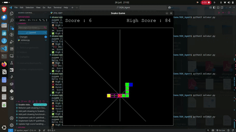

# 🚀 Mohamed Kamara — Software Engineering, Embedded Systems & Applied AI

[](https://www.linkedin.com/in/mohamed-kamara-a505b8256/)
[](https://mohamedkamara7613.github.io/Portfolio_page/)
[](https://github.com/mohamedkamara7613)
[](https://www.insa-rouen.fr/)

Bienvenue sur mon recueil central de projets d'ingénierie logicielle, de systèmes embarqués et d'intelligence artificielle appliquée.  
Je suis **élève-ingénieur en 4ème année à l'INSA Rouen Normandie** dans la spécialité **ISIA** (*Informatique, Systèmes et Intelligence Artificielle* / ex-ITI), après un parcours en **Classes Préparatoires aux Grandes Écoles (CPGE MP*)**.

Ce dépôt regroupe mes développements majeurs, conçus avec une exigence de rigueur mathématique, de performance bas niveau, de qualité logicielle (Clean Code, TDD, Design Patterns) et de documentation open-source.

---

## 📊 Dashboard Technique des Réalisations

| # | Projet | Domaine / Spécialité | Technologies Clés | Algorithmes & Concepts Piliers | Statut & Tests | Accès Dossier |
| :-: | :--- | :--- | :--- | :--- | :-: | :--- |
| **01** | **SmartRobot** | Robotique & Bas Niveau | `C`, `Make`, `CUnit`, `Doxygen` | A* (espace d'états), TSP (heuristique 2-opt), Graphes, TAD |  | [📁 `SmartRobot_C/`](./SmartRobot_C) |
| **02** | **SGBD SQL Engine** | Génie Logiciel & SGBD | `Java 21`, `POO`, `Bash`, `JUnit` | Moteur B-Tree, Buffer Pool (LRU), Parser SQL, ACID |  | [📁 `SGBD_SQL_Java21/`](./SGBD_SQL_Java21) |
| **03** | **Localisation Piéton EKF** | Systèmes Embarqués & Fusion | `Python`, `NumPy`, `Folium`, `C` | Filtre de Kalman Étendu (EKF), Gate de Mahalanobis, IMU/GPS |  | [📁 `Localisation_Pieton_EKF/`](./Localisation_Pieton_EKF) |
| **04** | **AutoDecomposer** | Traitement du Signal & Audio | `Python`, `NumPy`, `SciPy` | STFT custom from scratch, NMF stochastique, Séparation audio |  | [📁 `AutoDecomposer_Audio_NMF/`](./AutoDecomposer_Audio_NMF) |
| **05** | **Scanner Codes-Barres 1D** | Vision par Ordinateur | `C++`, `OpenCV`, `Python` | Morphologie mathématique, Détection Canny, Décodage optique |  | [📁 `Scanner_code_barres/`](./Scanner_code_barres) |
| **06** | **Snake Game AI & RL** | IA & Apprentissage Renforcé | `Python`, `PyTorch`, `Pygame` | Deep Q-Learning (DQN), Safe A* (fallback queue), BFS |  | [📁 `Autres/Python/Snake_Game/`](./Autres/Python/Snake_Game) |
| **07** | **Mario Sokoban Solver** | Algorithmique & Jeux | `C (SDL2)`, `Python (Pygame)` | Solveur BFS / A*, Espace d'états, Deadlock detection |  | [📁 `Mario_Sokoban_Version_Python/`](./Mario_Sokoban_Version_Python) |
| **08** | **Shazam Khassida** | Reconnaissance Audio | `Python`, `SQLite`, `FastAPI` | Empreinte acoustique (Spectrogram peaks), Hash pairing, Index |  | [📁 `Shazam_Khassida/`](./Shazam_Khassida) |
| **09** | **IA Puissance 4 & Gomoku** | IA Théorie des Jeux | `Python`, `Tkinter` | Minimax, Élagage Alpha-Bêta, Tables de transposition |  | [📁 `IA_puissance4/`](./IA_puissance4) |
| **10** | **Hand Tracking & Clic** | Vision par Ordinateur | `Python`, `OpenCV`, `MediaPipe` | Suivi squelette main 21 points, Filtrage lissage distance |  | [📁 `Autres/Python/Computer Vision/Hands_Detection/Click_Detection/`](./Autres/Python/Computer%20Vision/Hands_Detection/Click_Detection) |
| **11** | **Traitement Image Bas Niveau** | Algorithmique & Imagerie | `C`, `Bmp/Jpeg` | Convolutions matricielles, Canny, Correction gamma, N&B |  | [📁 `traitement d'image/`](./traitement%20d'image) |
| **12** | **Java Aventure RPG** | Architecture Logicielle | `Java 21`, `Design Patterns` | Command, State, Factory, Observer, Modularité SOLID |  | [📁 `Java_Aventure/`](./Java_Aventure) |

---

## 🌟 Projets Phares en Détail

### 1. 🤖 SmartRobot — Exploration Autonome & Résolution de Graphes en C
- **Problématique :** Traversée autonome et optimale d'un labyrinthe avec franchissement obligatoire de points d'intérêt sous contraintes mémoire et temps d'exécution stricts.
- **Architecture :** Conçu entièrement en **C standard (C99)** avec modularité poussée (Types Abstraits de Données - TAD, listes chaînées ordonnées, matrice d'adjacence).
- **Algorithmes :**
  - **A* (A-Star) sur espace d'états étendu :** Prise en compte de l'orientation du robot ($N, S, E, W$) pour pénaliser les rotations physiques coûteuses ($C_{\text{turn}} > C_{\text{move}}$).
  - **TSP (Voyageur de Commerce) :** Ordonnancement optimal des étapes via recherche exhaustive et heuristique 2-opt.
- **Rigueur industrielle :** Gestion de la mémoire sans fuite (vérifié sous **Valgrind**), suite de tests unitaires **CUnit**, génération automatique de documentation **Doxygen** et modélisation **PlantUML**.
👉 [Accéder au README détaillé du SmartRobot](./SmartRobot_C)

---

### 2. 🗄️ Moteur SGBD SQL relationnel from Scratch en Java 21
- **Problématique :** Concevoir le cœur d'un système de gestion de bases de données relationnelles sans aucune dépendance externe.
- **Composants implémentés :**
  - **Storage & Buffer Manager :** Gestionnaire de pages binaires sur disque couplé à un **Buffer Pool** en mémoire vive avec politique de remplacement **LRU (Least Recently Used)**.
  - **Indexation B-Tree :** Arbre B équilibré pour la recherche en temps logarithmique $O(\log N)$.
  - **Parser SQL :** Analyse syntaxique et exécution des instructions DDL (`CREATE TABLE`, `DROP`) et DML (`INSERT`, `SELECT` avec projections, clauses `WHERE`, agrégats et `JOIN`).
  - **Transactions ACID :** Support des mécanismes de verrouillage et de journalisation pour la cohérence des données.
👉 [Accéder au README détaillé du SGBD](./SGBD_SQL_Java21)

---

### 3. 📍 Localisation Piéton & Fusion Stochastique de Capteurs (EKF)
- **Problématique :** Estimer avec précision et fluidité la trajectoire d'un piéton en environnement urbain et indoor dense, malgré le bruit sévère des mesures GPS et la dérive inertielle de la centrale (IMU).
- **Approche scientifique :**
  - **Modélisation cinématique :** État d'espace d'états $\mathbf{x} = [p_N, v_N, p_E, v_E]^T$.
  - **Filtre de Kalman Étendu (EKF) :** Matrice de bruit de procédé $\mathbf{Q}$ calibrée expérimentalement sur accéléromètre en mouvement ($\sigma_a = 0.8596\text{ m/s}^2$).
  - **Gating de Mahalanobis :** Rejet statistique des trames GPS aberrantes et trames NMEA corrompues au seuil $\chi^2$ de $99\%$.
  - **Rendu cartographique :** Projection des trajectoires corrigées sur fonds de carte interactifs avec **Folium** et Leaflet.
👉 [Accéder au README détaillé de Localisation EKF](./Localisation_Pieton_EKF)

---

### 4. 🎵 AutoDecomposer — Séparation Audio par NMF & STFT Custom
- **Problématique :** Décomposition non supervisée de mélanges sonores polyphoniques en sources acoustiques élémentaires sans connaître a priori leurs spectres.
- **Réalisations algorithmiques :**
  - **Transformée de Fourier à Court Terme (STFT) from scratch :** Implémentation du fenêtrage (Hann, Hamming), du recouvrement (hop length) et de l'inversion spectrale (ISTFT / Overlap-Add).
  - **Factorisation Matricielle Non-Négative (NMF) :** Décomposition du spectrogramme d'amplitude $\mathbf{V} \approx \mathbf{W} \cdot \mathbf{H}$ par descente de gradient multiplicative minimisant la divergence de Kullback-Leibler ou Frobenius.
👉 [Accéder au README détaillé d'AutoDecomposer](./AutoDecomposer_Audio_NMF)

---

## 🎮 Démonstrations Visuelles Interactives

| **Mario Sokoban — Solveur d'états A*** | **Snake AI — Safe A* & Deep Q-Learning** |
| :---: | :---: |
|  |  |
| *Résolution automatisée de niveaux Sokoban par exploration de graphes et détection de deadlocks.* | *Algorithme A* temps réel avec mécanisme de sécurité vers la queue et agent DQN PyTorch.* |

| **Hand Tracking & Détection de Clic (OpenCV / MediaPipe)** |
| :---: |
|  |
| *Reconnaissance gestuelle en temps réel avec filtrage adaptatif de distance index-pouce.* |

---

## 🛠️ Boîte à Outils & Compétences Techniques

```
Langages de Programmation :
├── Bas Niveau & Embarqué   : C (C99/C11), C++ (C++17/20)
├── Systèmes & Back-End     : Java (Java 8 à Java 21 LTS), Python (3.8 à 3.12)
├── Scripts & Outils         : Bash / POSIX Shell, OCaml, SQL (PostgreSQL, MySQL, SQLite)
└── Web & Front-End         : HTML5, CSS3, JavaScript, React, Tailwind CSS

Systèmes & Méthodologies :
├── Environnements          : GNU/Linux (Ubuntu, Debian), POSIX, FreeRTOS
├── Outils de Build & Qualité: Make, CMake, GCC/Clang, GDB, Valgrind, Doxygen, Git / GitHub
├── Intelligence Artificielle: PyTorch, NumPy, SciPy, OpenCV, MediaPipe, Pandas, Scikit-Learn
└── Génie Logiciel           : Principes SOLID, Clean Architecture, Design Patterns GoF, TDD (JUnit, CUnit)
```

---

## 👤 Contact & Profil

- **Nom :** Mohamed Kamara
- **Formation :** INSA Rouen Normandie — Département ISIA (Informatique, Systèmes et IA)
- **Recherche :** Stage de Spécialité (Juin – Août 2027) & Alternance 5A (Contrat de Professionnalisation 2027-2028)
- **Email :** [mohamed.kamara@insa-rouen.fr](mailto:mohamed.kamara@insa-rouen.fr)
- **LinkedIn :** [linkedin.com/in/mohamed-kamara-a505b8256](https://www.linkedin.com/in/mohamed-kamara-a505b8256/)
- **Portfolio Web :** [mohamedkamara7613.github.io/Portfolio_page](https://mohamedkamara7613.github.io/Portfolio_page/)

---
*Dépôt maintenu et documenté avec rigueur par Mohamed Kamara.*
