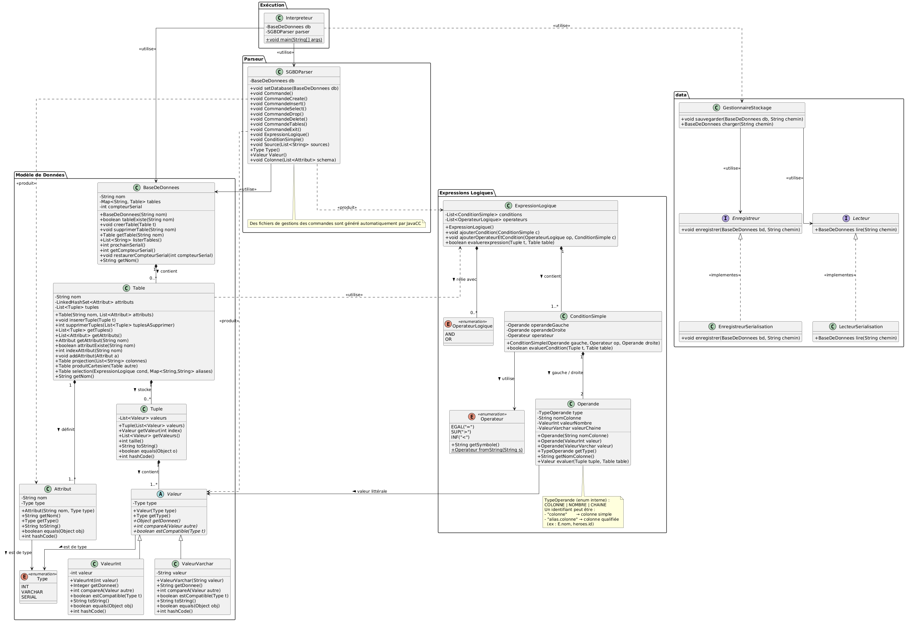
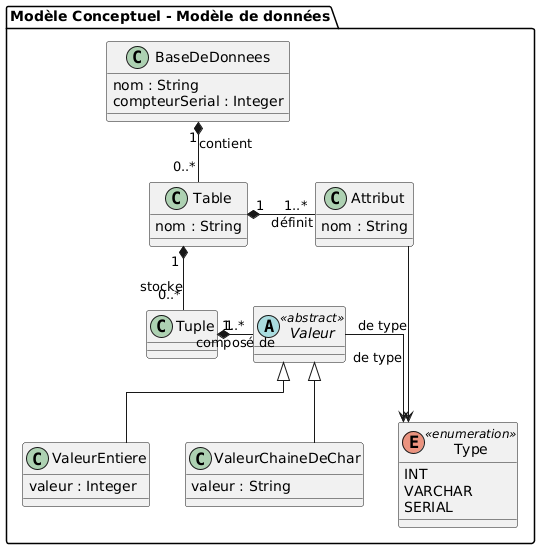
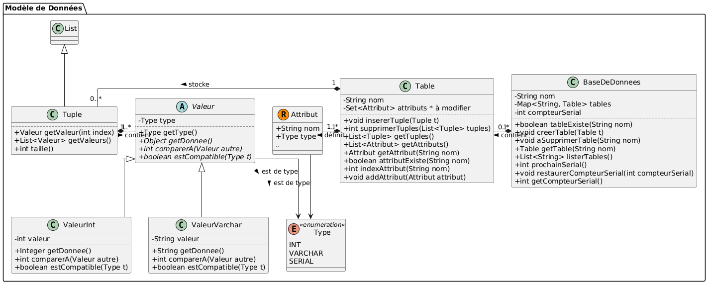
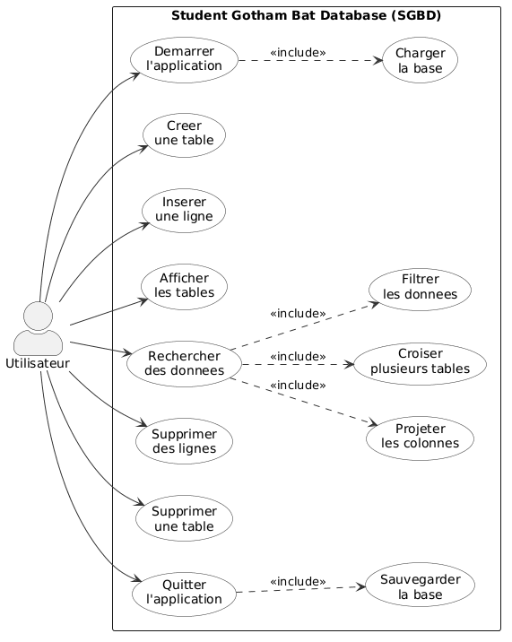

# 🗄️ SGBD SQL Engine — Moteur Relationnel from Scratch en Java 21

[](https://www.oracle.com/java/)
[](./docs)
[](./makefile)

Conception et implémentation intégrale d'un **système de gestion de base de données relationnelle (SGBD-R)** en **Java 21**, sans aucun framework externe ni dépendance tierce.  
Projet académique d'excellence à l'**INSA Rouen Normandie** (Département ISIA).

---

## 🏛️ Architecture du Moteur

```
                Requête SQL (Texte)
                        │
                        ▼
            [   SQL Parser / Lexer   ]  ──► Grammaire DDL & DML
                        │
                        ▼
            [    Query Processor     ]  ──► Plan d'exécution relationnel
                        │
                        ▼
            [    Table & Index B-Tree]  ──► Recherche indexée en O(log N)
                        │
                        ▼
            [  Buffer Pool Manager   ]  ──► Gestionnaire de cache mémoire (LRU)
                        │
                        ▼
            [ Disk Storage / Paging  ]  ──► Fichiers binaires paginés (.db)
```

---

## 💎 Fonctionnalités Maîtresses

### 1. Gestionnaire de Paginage & Buffer Pool (LRU)
- Les données sont stockées sur le disque dans des **blocs de taille fixe (pages binaires)**.
- Le **Buffer Pool** gère un ensemble de trames (frames) en mémoire vive avec un algorithme d'éviction **LRU (Least Recently Used)** et politique de *dirty pages write-back* pour limiter les I/O disque.

### 2. Indexation par Arbre B (B-Tree)
- Implémentation d'une structure d'**arbre B équilibré** permettant l'insertion, la recherche et la suppression en $O(\log N)$.
- Indexation sur clés primaires pour accélérer les clauses `WHERE id = ...`.

### 3. Syntaxe SQL Prise en Charge
- **DDL (Data Definition Language) :**
  - `CREATE TABLE <nom> (<colonne> <type>, ...);`
  - `DROP TABLE <nom>;`
- **DML (Data Manipulation Language) :**
  - `INSERT INTO <nom> VALUES (...);`
  - `SELECT <colonnes> FROM <table1> [JOIN <table2> ON ...] [WHERE <conditions>];`
  - Fonctions d'agrégation (`COUNT`, `SUM`, `AVG`, `MIN`, `MAX`).
  - `UPDATE` et `DELETE` avec filtrage booléen complexe.

---

## 📐 Modélisation & Conception UML

| Diagramme de Classes Complet | Modèle Conceptuel des Données |
| :---: | :---: |
|  |  |

| Modèle Physique de Stockage | Diagramme des Cas d'Utilisation |
| :---: | :---: |
|  |  |

---

## 🚀 Utilisation & Interpréteur Interactif

### 1. Compiler le projet
```bash
make clean
make
```

### 2. Lancer la console interactive SQL (REPL)
```bash
./Interpreteur.sh
```

### 3. Exemple de session SQL
```sql
SGBD> CREATE TABLE Etudiants (id INT, nom STRING, note FLOAT);
Table 'Etudiants' créée avec succès.

SGBD> INSERT INTO Etudiants VALUES (1, 'Mohamed', 18.5);
1 ligne insérée.

SGBD> INSERT INTO Etudiants VALUES (2, 'Thomas', 15.0);
1 ligne insérée.

SGBD> SELECT nom, note FROM Etudiants WHERE note >= 16.0;
+----------+-------+
| nom      | note  |
+----------+-------+
| Mohamed  | 18.5  |
+----------+-------+
1 ligne retournée.
```
