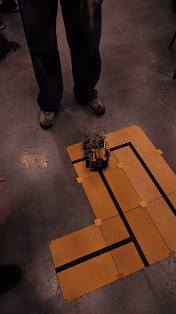
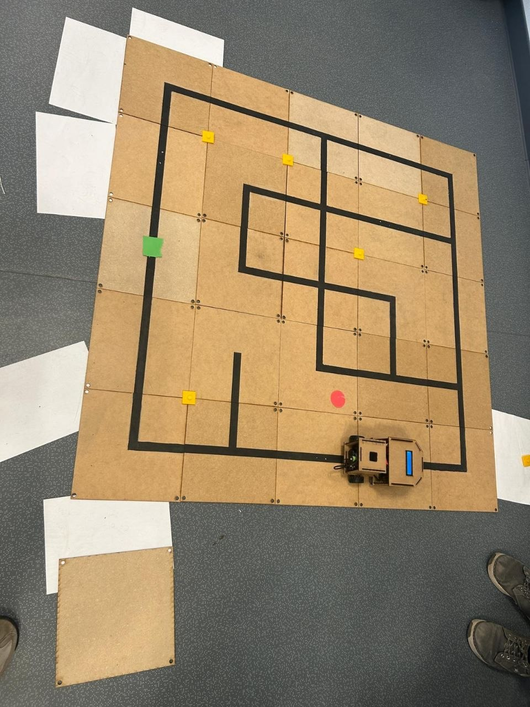
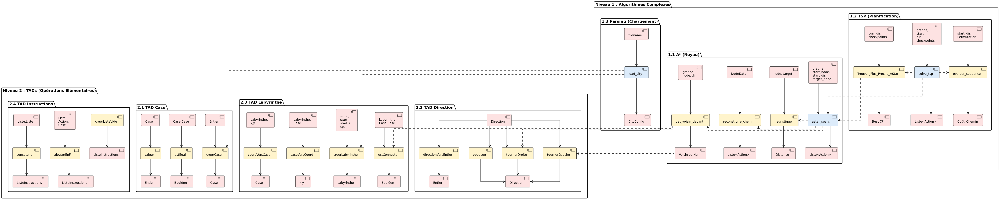

# 🤖 SmartRobot — Exploration Autonome & Résolution de Graphes en C

[](https://en.wikipedia.org/wiki/C99)
[](./Makefile)
[](./tests)
[](./Doxyfile)

Projet d'ingénierie intégrateur réalisé à l'**INSA Rouen Normandie** (Département ISIA).  
L'objectif est de programmer en **C embarqué** le comportement d'un robot autonome devant parcourir un labyrinthe complexe modélisé sous forme de graphe, franchir une suite de checkpoints imposés dans l'ordre de coût minimal, puis revenir à sa position de départ.

---

## 🎬 Démonstrations Visuelles Réelles

| **Robot Physique en Navigation Réelle** | **Montage Électronique Embarqué** |
| :---: | :---: |
|  |  |
| *Navigation autonome sur grille avec suivi de ligne optique et microcontrôleur.* | *Châssis différentiel, capteurs IR, écran LCD et bus de commande I2C.* |

---

## 🏗️ Architecture & Pipeline Algorithmique

```
   [ Labyrinthe ASCII ] ──► [ Parseur C ] ──► [ Matrice d'Adjacence & TAD Graphe ]
                                                        │
                                                        ▼
   [ Séquence Minimale ] ◄── [ Solveur TSP ] ◄── [ Calcul Tous-Paires (A*) ]
            │
            ▼
   [ Traduction Instructions ] ──► [ Bus I2C / PWM Moteurs ] ──► [ Déplacement Réel ]
```

### 1. Types Abstraits de Données (TAD) Piliers
- `Graphe` : Représentation par matrice d'adjacence pondérée avec gestion dynamique.
- `ListeChaineeListeOrdonnee (LCLO)` : File de priorité générique à coût minimal pour l'algorithme A*.
- `TableHachageDictionnaire` : Dictionnaire avec hachage pour mémoriser les états explorés en temps amorti $O(1)$.

### 2. A* sur Espace d'États Étendu
Contrairement à un A* classique sur coordonnées $(x, y)$, l'état du robot est un triplet :
$$s = (u, d) \quad \text{avec } u \in V \text{ (nœud)} \text{ et } d \in \{N, S, E, W\} \text{ (orientation)}$$
Le coût d'un déplacement intègre à la fois la translation physique et la pénalité angulaire :
$$c((u, d), (v, d')) = \text{distance}(u, v) + C_{\text{rotation}}(d, d')$$
Cette modélisation évite les zigzags physiques et minimise l'usure mécanique des moteurs.

### 3. Résolution du Voyageur de Commerce (TSP)
Pour relier les $K$ points de passage obligatoires, le solveur calcule d'abord la matrice de distance $K \times K$ via A*, puis détermine la permutation optimale par recherche avec heuristique 2-opt.

---

## 📊 Benchmarks & Modélisation

| Analyse de Complexité | Benchmarks Expérimentaux |
| :---: | :---: |
|  |  |

---

## 🚀 Compilation & Tests

```bash
# Compiler le projet
make clean && make

# Lancer la suite de tests CUnit
./run_test.sh

# Vérifier l'absence de fuite mémoire
valgrind --leak-check=full --show-leak-kinds=all ./bin/smartrobot
```
*(Résultat : 0 allocation perdue, 0 erreur mémoire).*

---

## 📑 Rapport d'Ingénierie & Spécifications
- 📄 [Consulter le Rapport Complet d'Ingénierie SmartRobot (PDF)](./docs/Rapport_PI_SmartRobot.pdf)
- 📋 [Consulter le Cahier des Charges & Spécifications (PDF)](./docs/Cahier_Des_Charges_SmartRobot.pdf)
