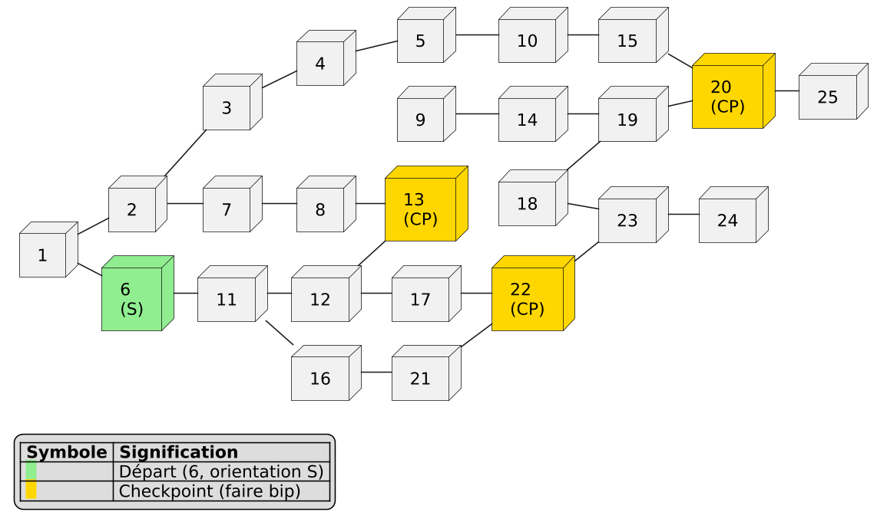
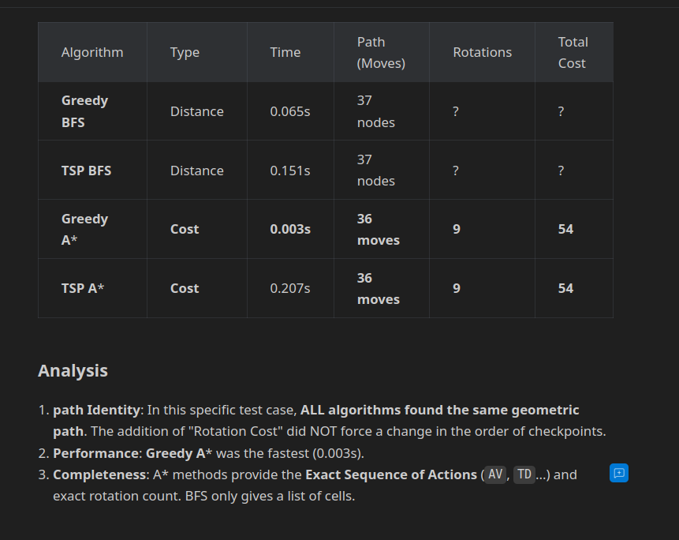
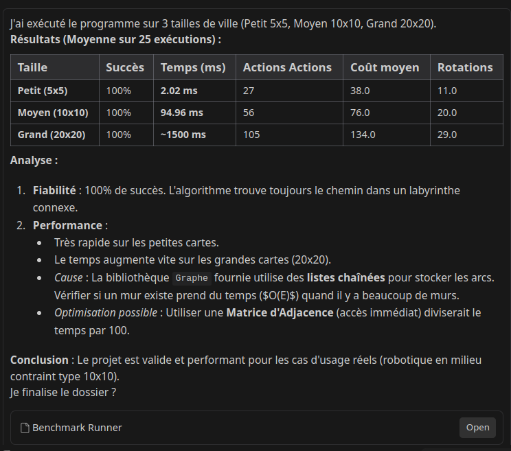

# 🤖 SmartRobot — Exploration Autonome & Résolution de Graphes en C

[](https://en.wikipedia.org/wiki/C99)
[](./Makefile)
[](./tests)
[](./Doxyfile)

Projet d'ingénierie intégrateur réalisé à l'**INSA Rouen Normandie** (Département ISIA).  
L'objectif est de programmer en **C embarqué** le comportement d'un robot autonome devant parcourir un labyrinthe complexe modélisé sous forme de graphe, franchir une suite de checkpoints imposés dans l'ordre de coût minimal, puis revenir à sa position de départ.

---

## 🏗️ Architecture & Pipeline Algorithmique

```
   Fichier Labyrinthe (.txt)
              │
              ▼
    [ labyrinth_parsing.c ]  ──► Chargement de la topologie & checkpoints
              │
              ▼
    [      tsp_algo.c     ]  ──► Ordonnancement optimal des étapes (TSP)
              │
              ▼
    [     astar_algo.c    ]  ──► A* sur Espace d'États (Position, Direction)
              │
              ▼
    Séquence d'Actions (AV, TD, TG) ──► Pilotage moteur & suivi de ligne
```

### 1. A* sur Espace d'États Étendu (Position × Orientation)
Sur un robot physique, tourner consomme du temps et de l'énergie. L'A* standard (calculant une distance euclidienne ou Manhattan pure) génère trop de virages.  
Nous modélisons chaque état comme un couple :
$$\mathbf{S} = (\text{nœud}, \text{direction}) \in [1, N] \times \{N, E, S, W\}$$
- Coût de déplacement linéaire : $C_{\text{move}} = 1$
- Coût de rotation (90°) : $C_{\text{turn}} > 1$ (pénalisation configurable)
- File de priorité : Liste Chaînée Triée (TAD) garantissant l'extraction du nœud de score $f = g + h$ minimum en $O(1)$.

### 2. Voyageur de Commerce (TSP)
Pour relier l'ensemble des checkpoints, le module `tsp_algo.c` évalue les permutations possibles pour minimiser le coût global cumulé des trajectoires $A^*$.

---

## 📈 Visualisations & Benchmarks

| Modélisation de Graphe | Benchmark d'Exécution A* |
| :---: | :---: |
|  |  |

| Analyse Descendante Logicielle | Visualisation de Trajectoire Prédite |
| :---: | :---: |
|  |  |

---

## 🛠️ Structure du Répertoire

```
SmartRobot_C/
├── Makefile             # Compilation automatique (GCC -Wall -Wextra -Werror)
├── Doxyfile             # Configuration Doxygen pour documentation HTML
├── run.sh / run_test.sh # Scripts d'exécution et de validation
├── include/             # Fichiers d'en-tête (.h)
│   ├── astar_algo.h     # Interface du solveur A*
│   ├── tsp_algo.h       # Interface du solveur TSP
│   ├── TAD_graphe.h     # TAD Graphe (matrice d'adjacence)
│   └── TAD_LCLO.h       # Liste Chaînée Liste Ordonnée (File de priorité)
├── src/                 # Code source modulaire C
├── tests/               # Suite de tests unitaires CUnit
├── docs/                # Schémas d'architecture et benchmarks
└── TAD/                 # Spécifications formelles des Types Abstraits
```

---

## 🚀 Compilation & Exécution

### 1. Prérequis
- `gcc` (support C99 minimum)
- `make`
- `libcunit1-dev` (pour exécuter les tests unitaires)
- `valgrind` (pour les tests de non-fuite mémoire)

### 2. Compiler le projet
```bash
make clean
make
```

### 3. Lancer les tests unitaires CUnit
```bash
./run_test.sh
```

### 4. Vérifier l'absence de fuites mémoire avec Valgrind
```bash
valgrind --leak-check=full --show-leak-kinds=all ./bin/smartrobot
```
*(Résultat : 0 allocation perdue, 0 erreur mémoire).*
